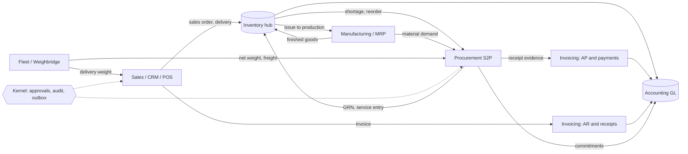

# Product architecture: demand side, supply side and the hub

Status: **proposed change document** (2026-10-30). This page is the business view. Technical layering is covered in
[`ARCHITECTURE.md`](ARCHITECTURE.md), and module rules in `AGENTS.md`.

## The idea

The ERP is one flow of goods and money. Each module owns one part of that flow:

| Side | Module(s) | Owns |
|---|---|---|
| **Demand** | `crm` (sales suite, ADR-S010), `orders`, `pos`, `invoicing` (customer side) | Leads, quotations, sales orders, deliveries, customer invoices, receipts |
| **Supply** | `procurement` (Source-to-Pay, [ADR-PROCUREMENT-001](adr/ADR-PROCUREMENT-001.md)), `invoicing` (supplier side) | Requisitions, sourcing, agreements, POs, receipts and evidence, supplier bills, supplier payments |
| **Hub** | `inventory` | Stock, valuation, cost layers, landed-cost revaluation |
| **Transform** | `manufacturing` | Consumes stock, produces stock, and raises demand on the supply side (MRP) |
| **Execute** | `fleet` | Transport, weighbridge, fuel, maintenance; feeds both sides |
| **Record** | `accounting` | GL, periods, budgets and commitments, reconciliation |
| **Govern** | `kernel` | Approvals, workflow, audit, sequences, idempotency, outbox, settings, files |

## Rules

1. One owner per concept. No module keeps a second ledger, payment engine or valuation for something another module
   owns.
2. Sides talk through application ports and events, never through each other's tables (`ModularityTests`).
3. Demand and supply mirror each other. Quotation ↔ supplier quotation, sales order ↔ purchase order, delivery ↔ goods
   receipt, customer invoice ↔ vendor bill, credit note ↔ debit note. Shared UX and validation patterns should be
   reused.
4. Policies are configuration, not code: effective-dated, approved and audited (see
   [procurement approval policies](spec/procurement-approval-policies.md)).

## Supply-side documents

See [`spec/procurement.md`](spec/procurement.md#target-source-to-pay-design-adr-procurement-001),
[postings](spec/procurement-postings.md), [landed cost](spec/procurement-landed-cost.md) and
[integration contracts](spec/procurement-integration-contracts.md).
