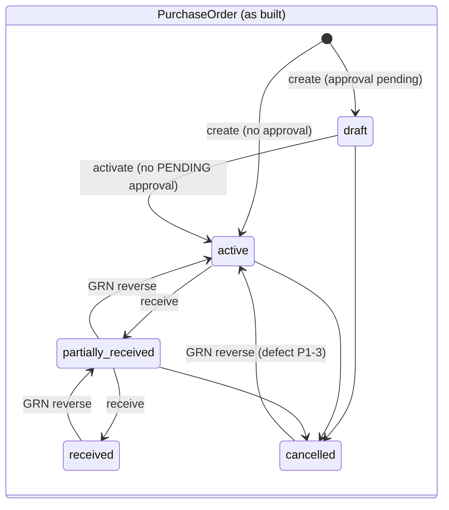
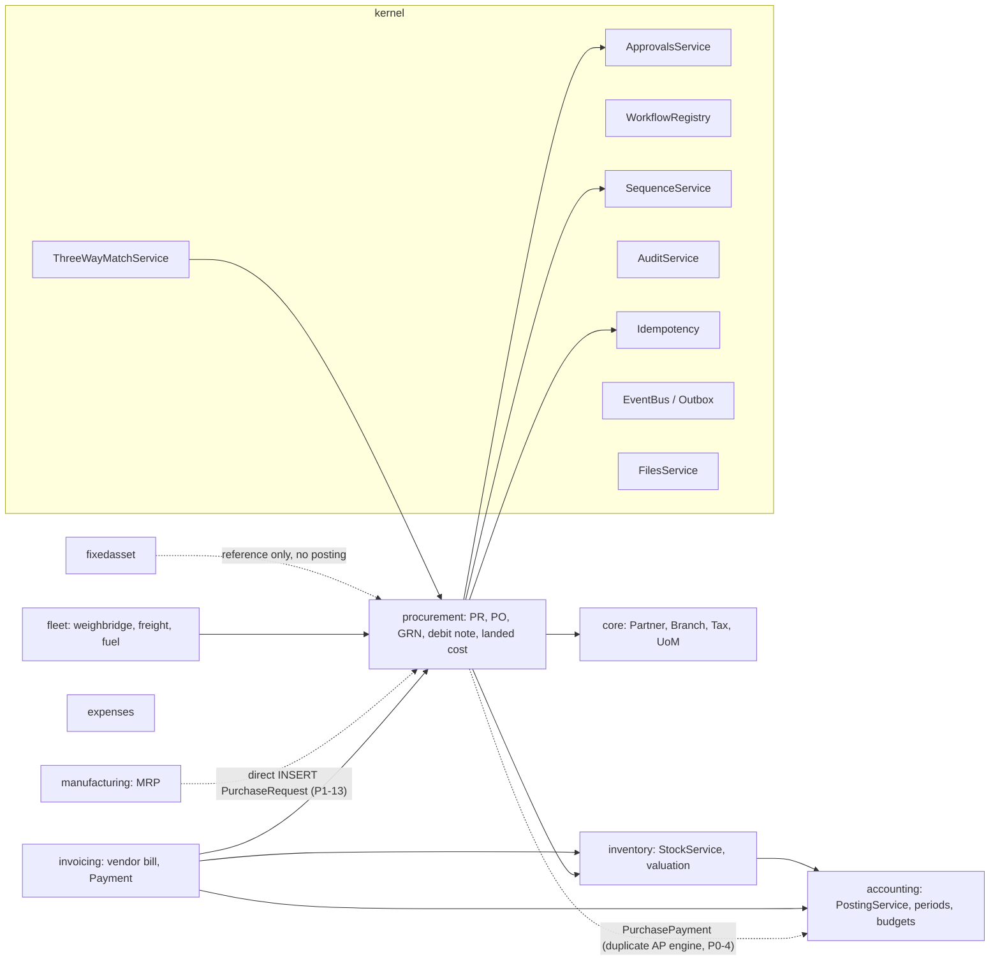

# Procurement / Source-to-Pay — current-state audit

- Date: 2026-10-30 · Scope: `procurement`, plus its integration with `invoicing`, `inventory`, `accounting`, `core`,
  `kernel`, `manufacturing`, `fleet`, `fixedasset` and `expenses`
- Type: **audit and design only.** No code, migration or route was changed.
- Companion documents: [ADR-PROCUREMENT-001](../adr/ADR-PROCUREMENT-001.md) ·
  [target spec](../spec/procurement.md#target-source-to-pay-design-adr-procurement-001) ·
  [postings](../spec/procurement-postings.md) · [landed cost](../spec/procurement-landed-cost.md) ·
  [approval policies](../spec/procurement-approval-policies.md) ·
  [integration contracts](../spec/procurement-integration-contracts.md) ·
  [roadmap](../roadmap/procurement-roadmap.md)
- Earlier assessments: [`docs/audits/2026-10-27-accounting-inventory-assessment.md`](../audits/2026-10-27-accounting-inventory-assessment.md)
  rated AP / procure-to-pay 7/10, and [`docs/audits/2026-10-27-phase-a-parity-run.md`](../audits/2026-10-27-phase-a-parity-run.md)
  planned fixes B1/B2/B6/B7. This audit goes deeper and records defects those two did not.

Paths below are relative to `backend/src/main/java/com/inventoryerp/` unless they start with `docs/`, `web/` or `backend/`.
Line numbers are as of commit `HEAD` on 2026-10-30. Abbreviations:
- `POS` = `procurement/application/PurchaseOrdersService.java`
- `GRS` = `procurement/application/GoodsReceiptsService.java`
- `DNS` = `procurement/application/DebitNotesService.java`
- `TWM` = `kernel/threewaymatch/ThreeWayMatchService.java`
- `IWI` = `invoicing/application/InvoicingWorkflowsInitializer.java`
- `SS` = `inventory/application/StockService.java`
- `IT` = `backend/src/test/java/com/inventoryerp/procurement/ProcurementIT.java`

---

## 1. Executive summary

**Already strong.**
- All 36 Nest parity routes are ported and ticked in `docs/PORT_STATUS.md`. `IT` is about 1,100 lines and covers 24
  scenarios, and `LandedCostVoucherIT` plus `ProductUnitsIT` add more.
- Receiving is atomic: GRN, stock ledger, valuation and GL are written in one transaction.
- Over-receipt is blocked, and PO lines and the PO header use optimistic version checks.
- AVCO uses a row lock (`SS` 278 `lockQuantForAvco`). FIFO uses layers and STANDARD costing is in place (ADR-S008).
- The GL is idempotent through `postingKey` (`accounting/application/PostingService`).
- Landed-cost vouchers work across several receipts and suppliers, with a generated supplier bill per charge
  (ADR-S007, V14).
- Bills are matched to receipts quantity by quantity (`invoicing/application/BillReceiptMatcherService`).
- The weighbridge already creates GRN drafts (`fleet/application/WeighbridgeTicketService`, V23).
- MRP raises purchase requests.

**What blocks an enterprise S2P build.**
- Six verified **P0 financial-integrity defects** (§5), including a GRNI/AP imbalance on standard-cost receipts, AP
  credited twice after a PO delete, and stock issued twice by debit notes.
- Procurement runs its own payment engine (`PurchasePayment`), which bypasses invoicing AP, approvals and WHT.
- Foreign currency is ignored on the receipt path.
- There is no sourcing (RFQ / quotations / awards), no agreements, no PO change control, no service receiving, no
  incoming inspection, no commitment-based budget control and no supplier qualification.

**Recommendation: CONDITIONAL GO** (§9).

## 2. Capability matrix (current versus target)

Classification legend: **IV** = implemented and verified (tested) · **II** = implemented but incomplete ·
**PA** = partially implemented · **UI** = UI only · **BE** = backend only · **AB** = planned but absent ·
**DU** = defective or unsafe.

| # | Capability | Now | Evidence | Target (see spec) |
|---|---|---|---|---|
| 1 | Supplier and vendor management | **PA** | Generic `core/domain/Partner.java` with `isSupplier` and `status` (active / inactive / archived). `web/src/pages/suppliers.tsx` wraps `PartnersList`. No bank accounts, currency, qualification, certificates or "blocked" status. Procurement and invoicing never check `isSupplier` or `status`. | `SupplierProfile` extension: qualification lifecycle, bank accounts under dual control, certificates with expiry, scorecard |
| 2 | Purchase requisitions | **PA / DU (UI)** | `PurchaseRequestsService` `create` / `submit` / `approve` / `reject` / `remove`; test `IT.purchaseRequests` (213). `converted` and `cancelled` are never set. PO create stores `requestId` without checking the org or that the request is approved (`POS` 178–184). Web links to `/procurement/purchase-requests/new`, which has no route, and "Convert to PO" passes `?requestId`, which `purchase-order-create.tsx` ignores. | Requisition with lines, sourcing status, partial conversion, consolidation, demand sources |
| 3 | RFQs and supplier quotations | **AB** | No tables, services or screens. | RFQ, RfqSupplier, SupplierQuotation (with revisions) |
| 4 | Supplier evaluation and awards | **AB** | — | Weighted evaluation and per-line award |
| 5 | Purchase agreements and contracts | **AB** | Only rental and repair contracts exist. | Blanket and rate agreements with releases |
| 6 | Purchase orders | **IV** | `POS` `create` 131, `update` 757, `cancel` 806, `remove` 836, `activate` 854; `IT.creditPurchase` 278, `cashPurchase` 312, `purchaseOrderAdmin` 478 | Full lifecycle, using the statuses that exist but are never set (§3) |
| 6b | PO amendments | **AB** | `update` edits header fields only. The `snapshot`, `parentOrderId` and `sentAt` columns are unused. | `PoRevision` / change request with re-approval |
| 7 | Goods receipts | **IV** (with defects) | `POS.receive` 506; `GRS` `createDraft` 139, `post` 236, `createAdhoc` 106, `reverse` 382, `cancelDraft` 533; `IT.receiptStatusAndGuards` 335, `receiveIdempotency` 381, `goodsReceipts` 556, `poLinkedReceiptReversal` 635 | Plus weighbridge policy, inspection, put-away location |
| 8 | Service receiving | **AB / DU** | No service entry. `SS.receiveCore` never checks `productType` or `trackInventory`, so a service product on a PO is put into stock. | `ServiceEntrySheet` |
| 9 | Supplier returns | **PA / DU** | Return to vendor works: `DNS.postSupplierReturn` 284; tests `IT.returnToVendor` 861 and `ProductUnitsIT`. An inbound debit note that is not a return always fails "Unbalanced entry" (parity bug B1). There is no GRN/PO link (`documentId` is free text), no check against the quantity received, and no tax (`taxAmount` is hard 0, `DNS` 141). The double-post race is P0-3. | Return order linked to GRN lines, with claim and credit note |
| 10 | Vendor bills and AP integration | **II** | Bills are `"Document"` rows with `documentType='vendor_bill'` (`invoicing/application/VendorBillService`). Posting is `IWI.postBill`. Receipt matching is `BillReceiptMatcherService.matchLine` / `consume` / `releaseForBill`. Tests: `IT.billMatching` 886, `receiptThenBill` 935, `billInPurchaseUnit` 960. PO link is `VendorBillLink`, which splits the bill **total, tax included,** evenly across POs (`VendorBillService` 248). No duplicate-bill check. | Invoicing stays the owner; add duplicate detection, a matching policy and a prepayment link |
| 11 | Purchase payments | **DU** (design) | Two engines. (a) `POS.pay` 670 and `settleCashReceipt` 466 write `PurchasePayment` and post Dr AP / Cr cash through `StockPostingService.postPurchasePayment`. (b) `invoicing/application/PaymentService.record` writes `Payment` / `PaymentAllocation`, with WHT and the `supplier_payment` approval. Engine (a) bypasses residuals, approval and WHT (P0-4). | One engine: invoicing `PaymentService` |
| 12 | Landed costing | **IV** | Legacy single-GRN: `LandedCostService` (`IT.landedCostAvco` 722, `landedCostFifoLot` 788). Voucher-based: `LandedCostVoucherService`, `ShipmentService`, `CostComponentService`, `LandedCostLayers` (consumed share to COGS, reclass on reversal), V14 `billMode` generate / link / none; `LandedCostVoucherIT` (9 tests). Web: `web/src/pages/costing/*`. | Estimated accrual with true-up, credit note per charge, shipment basis, reconciliation (see landed-cost spec) |
| 13 | Purchase price variance | **PA / DU** | On bills: `IWI` 236–278 (`purchase_price_variance` mapping). Standard cost: `StandardCostService.postReceipt` 119 (PPV account 5905). Broken for standard-cost products received through a PO (P0-1). Price differences on vouchered receipts are dropped (P1-7). | PPV and invoice price variance by policy |
| 14 | Inventory valuation and GRNI | **II / DU** | `StockPostingService.postReceipt` (Dr `stock_valuation` / Cr `grni_accrued`) and `postReceiptVoucher` (Dr GRNI and input tax / Cr AP). `GrniReconciliationService.report` (`IT.grniReport` 1013) has no web screen. GRNI residue comes from P0-1, and misclassification from P0-2. | Invariant-checked GRNI with an ageing screen |
| 15 | Supplier statements and reconciliation | **DU** | `VendorBillService.ledger` drops paid bills, so the balance goes negative (parity bug B2). AP ageing is `invoicing/application/ApAgingService`. There is no open-item AP matching and no statement import. | BigDecimal ledger equal to ageing and GL; statement reconciliation |
| 16 | Budgets and approval workflows | **PA** | Approvals are gated in PO create, GRN post / receive and debit-note post, using `kernel/approvals/ApprovalsService.checkOrRequestApproval`. Nothing in procurement listens to `approval.decided`. `activate` checks only for **pending** approvals (`POS` 859), so a PO whose approval was rejected can still be activated. `accounting/application/BudgetService` reads posted actuals only, with no commitments. | Policy-driven approvals with segregation of duties; commitment and encumbrance budgets |
| 17 | Procurement reporting | **PA** | GRNI, three-way-match list (`web/src/pages/three-way-match.tsx`) and landed-cost reports. No open-PO, overdue, spend, price-history or supplier-performance reports. PO `?search=` returns 500 (parity bug B6, `POS` 256–260). | Operational, financial, supplier and industry reports (roadmap P5) |
| — | Three-way match | **DU** | `TWM.recomputeForOrder` 45: received quantity sums **all** GRN lines, including draft, reversed and cancelled (`TWM` 68–70). The billed amount is the tax-inclusive, evenly split `VendorBillLink.amount`. All arithmetic is `double`. Write routes need only `three_way_match:read` (`procurement/web/ThreeWayMatchController` 35–44). `IT.threeWayMatch` 1041 asserts weakly. | Policy-driven 2/3/4-way match per line, in BigDecimal |

## 3. Document lifecycles as implemented

`PurchaseOrderStatus` also declares `submitted`, `approved`, `sent`, `acknowledged`, `billed` and `closed`. No code
ever sets them, so a PO never closes. A PO can be hard-deleted in any status except received or cancelled (P0-2).

The PR lifecycle is draft → submitted → approved, and draft or submitted → rejected. `converted` and `cancelled` are
unreachable. A GRN goes draft → posted → reversed, or draft → cancelled (`cancelDraft`, used by the weighbridge void).
A landed-cost voucher goes draft → submitted → approved → posted → reversed, but it can also be approved directly from
draft (P1-10). A debit note goes draft → posted, or draft → cancelled.

## 4. Traced transaction path (PO → GL)

| Step | Code | Ledger effect | Posting key / guard |
|---|---|---|---|
| PO create | `POS.create` 131. The approval gate runs in `REQUIRES_NEW` (documented parity deviation). | none | none |
| Receive | `POST /purchase-orders/{id}/receive` (`@Idempotent(required=true)`, controller 152) → `POS.receive` 506. Alternatively, a GRN draft followed by `PATCH /goods-receipts/{id}/post` (`@Idempotent(required=true)`), where the draft is claimed with `UPDATE … WHERE status='draft'` (`GRS` 284). | — | Interceptor-level idempotency |
| Apply to PO | `POS.applyReceiptToPO` 322 | Updates `receivedQuantity`. Over-receipt is a hard block, computed in `double` (358–367). Version checks on each PO line (371) and on the PO (388). | Optimistic lock |
| Stock in | `SS.receiveForDocument` → `receiveCore`. Period check 224. Base-unit conversion `toBaseQtyCost` 248. Lock 278. `CostResolver.resolveReceiptCost` 281. Ledger row 340. | AVCO / FIFO: `StockPostingService.postReceipt` Dr `stock_valuation` / Cr `grni_accrued` at actual. STANDARD: `StandardCostService.postReceipt` Dr stock at standard, ± PPV 5905, Cr GRNI at **actual** (`SS` 351–355). | GL `postingKey` |
| Receipt voucher | `StockPostingService.postReceiptVoucher` (called at `POS` 622, `GRS` 349) | Dr `grni_accrued` (`receiptNet`) + Dr `tax_receivable` / Cr AP. **AP is recognised at receipt.** | `receipt_voucher:goods_receipt:{grnId}` |
| Cash PO | `POS.settleCashReceipt` 466 | Dr AP / Cr cash. Writes a `PurchasePayment` and a drawer pay-out, and needs the caller's open till. | `purchase_payment:goods_receipt:{grnId}` |
| Vendor bill | `VendorBillService.post` → `IWI.postBill` 206–304 | Quantity already vouchered by a receipt is skipped (241–243). Accrued (ad-hoc) quantity: Dr GRNI ± PPV. The rest: Dr expense / GRNI and Dr input tax / Cr AP. Stock quantity with no receipt is auto-received through `SS.receiveFromBill`. | `vendor_bill:{id}` |
| Payment | (a) `POS.pay` 670 → `PurchasePayment`. (b) `PaymentService.record` → `Payment` + `PaymentAllocation`, Dr AP / Cr bank / Cr `withholding_payable`. | Dr AP / Cr cash or bank | (a) `@Idempotent(required)`. (b) the route is in `IdempotencyService.OUTCOME_ROUTES`. |
| Landed cost | `LandedCostVoucherService.post` → `LandedCostLayers.apply` | Dr stock (on-hand share), Dr COGS (consumed share), Dr expense, Dr `tax_receivable` / Cr clearing 2155 or the supplier payable | Voucher keys |

### 4.1 Verification checklist (brief §3)

| Check | Result | Evidence |
|---|---|---|
| PO ↔ vendor-bill linking | **Defective** | Even, tax-inclusive split across POs (`VendorBillService` 248). Links from draft and cancelled bills are kept. |
| Partial and multiple receipts | **Verified** | `IT.receiptStatusAndGuards`, `goodsReceipts` |
| Partial and multiple invoices | **Partial** | `BillReceiptMatcherService` consumes receipt lines oldest first across **all** of the supplier's receipts, not only the linked POs. It reads them without `FOR UPDATE` (lines 52–57). |
| Receipt before invoice | **Verified with a gap** | `IT.receiptThenBill`. The bill-versus-receipt price difference on vouchered lines is lost (P1-7). |
| Invoice before receipt | **Partial** | The bill auto-receives stock (`receiveFromBill`). There is no open "billed, not received" state that a later receipt can clear against. |
| Duplicate receiving and posting | **Verified** for GRN and PO receive (atomic claim plus required idempotency). **Defective** for debit notes (P0-3) and after a PO delete (P0-2). | — |
| Over-receipt tolerance | **Verified as a hard block.** No tolerance per vendor or category. | `POS` 358–367 |
| Purchase UoM → stock UoM | **Verified**, pending owner approval of ADR-S003 (deviation D1) | `POS.receiptUnit` 644; `core/application/UomConversionService` |
| Receiving location | **Partial.** Location existence is checked in the org (`POS` 514), but not its type or active flag. `create` requires `warehouseId` and then discards it (no column). | `POS` 136–141 |
| Stock valuation and AVCO locking | **Verified** | `SS` 278 |
| GRNI clearing | **Defective** for STANDARD products (P0-1) and after a PO delete (P0-2) | — |
| PPV | **Defective** (P0-1, P1-7) | — |
| Supplier returns and credit notes | **Partial / defective** (B1, P0-3; debit notes never reduce bill residuals) | — |
| Foreign currency and realized FX | **Absent / defective** (P0-5) | — |
| WHT and VAT | **Partial.** WHT is taken only at payment (`PaymentService.record`). No WHT certificate or report. Input VAT is posted at receipt from the PO line `taxRate`. | — |
| Fiscal period controls | **Verified** on stock and GL (`SS.assertStockPeriodOpen`, `FiscalPeriodControl.assertOpen`). **Gap:** legacy `LandedCostService.assertPeriodOpen` 329 checks the books lock date only. | — |
| Reversal and correction | **Partial.** GRN reversal is guarded (landed cost, bill, payment). A posted legacy landed cost cannot be reversed. A GRN reversal does not lock the GRN against a concurrent landed-cost post (P1-6). | `GRS` 382–486 |

## 5. Defect register

Every row was re-read in source on 2026-10-30. **P0** means money, stock or tenancy integrity can break under normal
use. **P1** means the control is weak or wrong but needs an unusual sequence of steps or loses no money directly.
"Parity" marks behaviour copied from Nest on purpose. It is still fixed post-parity as a labelled
`fix(<module>)!: … (post-parity)` commit.

| ID | Sev | Defect | Evidence | Repro sketch | Fix owner |
|---|---|---|---|---|---|
| P0-1 | P0 | STANDARD-cost receipt through a PO / GRN leaves a GRNI residue equal to the PPV and understates AP. `Received.totalValue` is valued at standard. The voucher debits GRNI with that value (standard), while `std.postReceipt` credited GRNI at actual. Cash settlement then pays the standard amount. | `SS` 255, 352–355, 380; `POS` 615–622; `GRS` 338–349 | Product standard 100, PO price 110, receive 10. GL: GRNI Cr 1,100, Dr 1,000, residue 100. AP is 1,000 although the supplier is owed 1,100. Untested: `StandardProcessCostingIT` uses an ad-hoc GRN, which posts no voucher. | procurement + inventory |
| P0-2 | P0 | A partially received PO can be hard-deleted. The GRN foreign key is `ON DELETE SET NULL`, so receipts already vouchered look "ad-hoc". `BillReceiptMatcherService` then treats them as accrued, and the bill credits AP a second time. | `POS.remove` 836–851 (blocks only received / cancelled); V1 foreign key on `GoodsReceiptNote.purchaseOrderId` | Receive 5 of 10, delete the PO, post a bill for 5: AP is credited at receipt and again by the bill. | procurement |
| P0-3 | P0 | Debit-note post can issue stock twice. There is no `@Idempotent` (`DebitNotesController` 95), the draft check runs before the transaction (`DNS` 206), and `markPosted` has no `status='draft'` guard (268–276). Two concurrent posts each call `stock.issue` (309), but the GL replays one entry by posting key. | `DNS` 206, 268–276, 309 | Two parallel `PATCH /debit-notes/{id}/post`: stock goes out twice, the GL records it once, and the stock and GL no longer agree. | procurement |
| P0-4 | P0 | **Correction (2026-10-30, wave 1):** the two payment paths settle *different* liabilities — `PurchasePayment` pays the AP the receipt voucher raised (which has no bill document), while a vendor bill's residual carries only what receipts did not voucher (`IWI.postBill` sets `amountResidual = postableTotal`), so they do not double-pay each other. The real defect is missing controls. **Fixed:** pay refuses draft orders and is capped at what posted receipts vouchered. Original finding: procurement has its own payment engine. `PurchasePayment` bypasses invoicing `Payment`/allocation, bill residuals, the `supplier_payment` approval and WHT. `pay` accepts draft and active POs that have no receipt, and caps payment at the ordered total, so AP can go into debit. | `POS` 466, 670–741 (only cancelled is blocked, 686) | Pay a credit PO before receiving: Dr AP with no matching credit. The bill residual stays fully open, so the bill can be paid again through `PaymentService`. | invoicing (owner) + procurement |
| P0-5 | P0 (multi-currency orgs) | PO `currencyCode` / `exchangeRate` are ignored on the receipt, voucher and PO payment postings, so foreign amounts post as base currency. Supplier payments carry no currency, so there is no realized FX. | `StockPostingService.postReceiptVoucher` / `postPurchasePayment` (posted with `PostingRequest.of`, no currency); `invoicing/application/PaymentService` | A USD PO at 3,700 UGX: stock and AP are booked as USD amounts in UGX. | inventory + invoicing + accounting |
| P0-6 | P0 (tenancy) | Foreign ids from the request are stored without an org check and read back by id alone. | `POS` 178–184 (`requestId`, `branchId`), 305–306 (`SELECT * FROM "PurchaseRequest" WHERE id = ?`); `GRS` 161–162, 569–570 (`SELECT * FROM "PurchaseOrder" WHERE id = ?`) | Org A creates a PO with org B's `requestId`, and `GET /purchase-orders/{id}` returns org B's request. | procurement |
| P1-1 | P1 | Three-way match: received quantity counts every GRN status; billed amount is a tax-inclusive even split; `double` math; write routes guarded only by `read`. | `TWM` 68–70; `VendorBillService` 248; `ThreeWayMatchController` 35–44 | Any tax rate above the tolerance shows a "blocked" price variance. A reversed GRN still counts as received. | kernel / procurement |
| P1-2 | P1 | A PO whose approval was rejected can still be activated, because only pending requests are checked and no procurement listener reacts to `approval.decided`. | `POS` 859–866 | Reject the approval, then call `activate`: the PO becomes active. | procurement |
| P1-3 | P1 | GRN reversal overwrites PO status without a status guard, so a cancelled PO becomes active again. `receivedQuantity` is decremented without a version check or a floor at zero. | `GRS` 465, 482–486 | Cancel a partially received PO, then reverse its GRN: the PO is active again. | procurement |
| P1-4 | P1 | Approvals key on entity id, so any earlier APPROVED request counts and the amount is never re-checked. `supplier_payment` is keyed on the **partner** id, so one approval approves every later payment to that supplier. | `ApprovalsService.checkOrRequestApproval` ~269–274; `PaymentService.createSupplierPayment` | Approve a 1M payment; a later 100M payment to the same supplier needs no approval. | kernel / invoicing |
| P1-5 | P1 | Bill post `overrideApproval` lets the poster approve their own pending request (segregation-of-duties breach). | `VendorBillService.post` | — | invoicing |
| P1-6 | P1 | GRN reversal and landed-cost post race. The reversal checks posted landed cost outside its transaction without locking the GRN (`GRS` 398), and `LandedCostService.post` reads the GRN unlocked. Draft landed costs are cancelled before the refusal checks run (406, parity bug B7). | `GRS` 398–406 | — | procurement |
| P1-7 | P1 | On vouchered PO receipts, the bill-versus-receipt price difference is skipped, so AP stays at the receipt value. Bill matching reads open receipt lines without `FOR UPDATE`, so concurrent bills can over-consume `billedQuantity`. | `IWI` 241–243; `BillReceiptMatcherService` 52–57 | — | invoicing |
| P1-8 | P1 | `double` money and quantity arithmetic, against the rule in `AGENTS.md` §8. | `POS` 151–161, 349–366, 703; `DNS` 108–112, 146, 210–212; `TWM` throughout | Rounding drift on large tonnage multiplied by price. | procurement / kernel |
| P1-9 | P1 | No duplicate supplier-invoice check (supplier + reference) on vendor bills. Only fleet has one (`FleetFreightBillService`). | `VendorBillService.create` | — | invoicing |
| P1-10 | P1 | A landed-cost voucher can be approved from draft, skipping submit. A PR can be approved by its requester. | `LandedCostVoucherService` ~312; `PurchaseRequestsService.approve` 174 | — | procurement |
| P1-11 | P1 | Events are published after the transaction completes **on commit or rollback** (`kernel/common/DetachedWrites` 118, which never checks `status`). This is a deliberate Nest-parity design, documented in the class Javadoc, but a rolled-back post can still emit `*.posted` events. Kernel-wide. | `kernel/common/DetachedWrites.java` 1–20, 118 | — | kernel (separate ADR) |
| P1-12 | P1 | Services are put into stock, and lines with no product advance the PO but never reach AP. | `SS.receiveCore` (no `productType` check); `POS` 600–604 | — | inventory / procurement |
| P1-13 | P1 | MRP inserts `PurchaseRequest` rows directly instead of going through `PurchaseRequestsService` (module-boundary breach). | `manufacturing/application/MrpPlanningService.firm` / `firmRun`; `MrpService.runMrp` / `scanMinStock` | — | manufacturing |
| P1-14 | P1 | Idempotency gaps on routes that change money or stock: debit-note create / post / cancel; PO create / update / cancel / activate / delete; every PR route; GRN draft create; voucher submit / approve / cancel; vendor-bill create / post (key optional). | `procurement/web/*Controller`, `invoicing/web/VendorBillController` | — | procurement / invoicing |
| P1-15 | P1 | The web client sends receive and pay with plain `api.post`, which mints a new Idempotency-Key per attempt. A double-click is two requests. | `web/src/lib/api.ts` 80–86 | — | web |
| B1 / B2 / B6 / B7 | parity | Inbound non-return debit note unbalanced; supplier ledger negative; PO search returns 500; GRN reversal cancels landed cost first. Already planned in `docs/audits/2026-10-27-phase-a-parity-run.md` §5. | `docs/spec/procurement.md` Deviations | — | procurement / invoicing |

### 5.1 Assumptions in the brief that the evidence does not support as stated

- *"Duplicate receiving"*: a PO / GRN receipt cannot be posted twice. The draft claim is atomic, the routes require
  idempotency and the version checks hold. Duplicate **stock movement** is possible only through debit notes (P0-3),
  and duplicate **AP** only after a PO delete (P0-2).
- *"Receiving-location resolution"*: the location is taken from the request and its existence is checked. The gap is
  validation of type and active flag (P1 hygiene), not mis-resolution.
- *"PO / vendor-bill linking"*: the link works. Its **amount** (tax-inclusive even split) is wrong for three-way match
  (P1-1).
- *"WHT"*: exists at payment. Certificates and reports are missing (Tier 1.2 of `docs/ROADMAP.md`).

## 6. Module ownership and integration map

| Integration | Current state | Problem |
|---|---|---|
| kernel `ApprovalsService` | Used for PO, GRN, debit note, vendor bill, supplier payment | Keyed by entity id with no amount re-check (P1-4). No procurement listener on `approval.decided` (P1-2). Gates run outside the transaction (parity). |
| kernel `WorkflowRegistry` | Used by invoicing (`vendorBillWorkflow`, `paymentWorkflow`) | Procurement does not use it; its state changes are hand-written SQL. |
| kernel `SequenceService` | `grn:<year>`, `purchase_request`, `MRPPR-` | OK; numbers have gaps by design. |
| kernel `AuditService` | `recordInTx` in procurement | OK |
| kernel outbox / events | `EventBus` → `DetachedWrites` | Events fire on rollback too (P1-11). `@ApplicationModuleListener` is unused. |
| kernel files | Generic `FilesService.upload(ownerType, ownerId)` | No document types or expiry. |
| kernel settings | `procurement.match_tolerance` feature flag only | No procurement policy layer. |
| core Partner | Supplier = partner flag | No qualification, bank accounts or supplier gate. |
| inventory | Clean API (`receiveForDocument`, `issue`, `receiveReturn`) | Services are put into stock (P1-12). Locations have no branch, parent or bins (Tier 2.1 WMS). |
| accounting | `PostingService` is idempotent and period-checked | Budgets read actuals only, with no commitments. `landed_cost_clearing` is missing from `contracts/account-mappings.json` and is created at runtime. |
| invoicing | Owns bills and `Payment` | Duplicated by `PurchasePayment` (P0-4). No duplicate-bill check. Debit notes never reduce residuals. |
| manufacturing | MRP raises draft PRs | Writes directly to procurement tables (P1-13). |
| fleet | Weighbridge creates the GRN draft (`WeighbridgeTicketService.feedGoodsReceipt`). Freight bill creates a landed-cost voucher (`FleetFreightBillService`). | Good. No *policy* yet that makes weighbridge evidence mandatory. Fuel purchases bypass PO and GRN. |
| quality | Production QC only (`manufacturing/application/QualityService`) | No incoming inspection. |
| fixedasset | `AssetAcquisition` stores `purchaseOrderId` / `invoiceId` as reference only | No asset-from-bill posting route. |
| expenses | `ExpensesService` posts only when paid | An expense on supplier credit raises no AP. |

**Duplicate ownership found:** supplier payments (procurement `PurchasePayment` versus invoicing `Payment`).
**Boundary breach:** MRP writes procurement tables directly. **No circular dependency** between application services
was found; `invoicing` → `procurement.domain` reads are allowed through the named interface.

## 7. Verified facts, recommendations and open decisions

**Verified facts:** §2 to §5, each with a cited line.

**Recommendations:** see the [roadmap](../roadmap/procurement-roadmap.md). In short:
1. Fix P0-1 to P0-6 plus B1, B2, B6 and B7 as post-parity fixes, each with an IT.
2. Make invoicing `PaymentService` the only payment engine. The PO `pay` route becomes an adapter, and parity JSON is
   kept.
3. Add the procurement policy layer and the S2P documents as additive extensions (ADR-PROCUREMENT-001).

**Open business decisions:** recorded in `docs/DECISIONS_FOR_OWNER.md`:
- The approval-matrix values.
- Uganda VAT / WHT treatment, confirmed by the client's accountant.
- Whether to deprecate PO `pay` and cash-PO auto-settlement.
- The default match mode (3-way, or 4-way for graded materials).
- Whether AP should stay receipt-based or move to bill-based recognition (§4 of the postings spec).
- Approval of ADR-S003 line units.

## 8. Test inventory (procurement)

`IT`: `purchaseRequests`, `creditPurchase`, `cashPurchase`, `receiptStatusAndGuards`, `receiveIdempotency`,
`payments`, `purchaseOrderAdmin`, `goodsReceipts`, `poLinkedReceiptReversal`, `receiptApprovalGate`,
`landedCostAvco`, `landedCostFifoLot`, `debitNotes`, `returnToVendor`, `billMatching`, `receiptThenBill`,
`billInPurchaseUnit`, `supplierPaymentWithholding`, `grniReport`, `threeWayMatch`, `tenantIsolation`,
`authorization`. Also `LandedCostVoucherIT` and `ProductUnitsIT`.

**Missing tests** (each one is an acceptance test in the roadmap):
- STANDARD-cost PO receipt with GRNI net zero.
- PO delete after a partial receipt.
- Concurrent debit-note post.
- Foreign-currency PO.
- Cross-org `requestId`.
- Rejected-approval activate.
- Cancelled PO, then GRN reverse.
- Concurrent bills against one receipt.
- Invoice before receipt, then the receipt.
- Three-way match with a reversed GRN.

## 9. Recommendation

**CONDITIONAL GO** for the first implementation phase:
- **GO** for **P0 foundation fixes** now. They are bounded, test-first, and use the existing post-parity fix process.
- **GO** for the policy, supplier and requisition work (roadmap P1) once every P0 acceptance IT is green and the
  owner has answered the open decisions above.
- **NO-GO** for sourcing, landed-cost extensions and industry features (roadmap P2 to P4) until P0 and P1 are
  complete. Building RFQs and agreements on a payment path that can double-count AP would multiply the defects.
