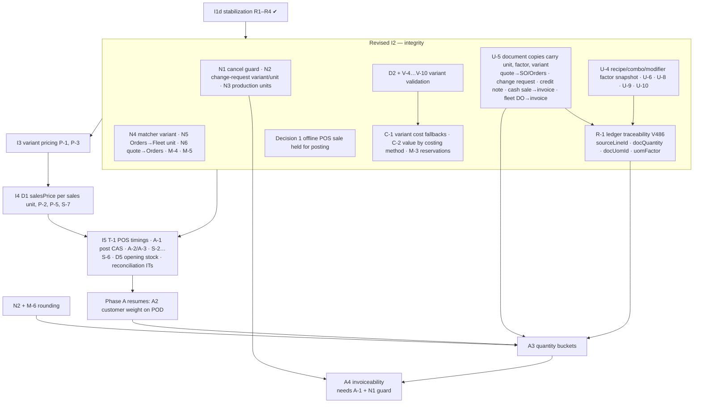

# Phase I regression and gap review (2026-11-15)

- Scope: the Phase I commits after the integrity audit (I1a `9522a3de`, I1c `cd0119f2`, I1b `c6c49bfa`, web
  `7d0aa8aa`, and the then-uncommitted pending-job retry and PO variant names), plus an end-to-end read of the
  inventory and unit-of-measure flows.
- Method: four independent read-only reviews (POS, units, web, end-to-end flows). Every finding marked ✔ was then
  re-checked in the code by hand. R1–R4 were then reproduced by a failing test before they were fixed.
- Earlier audit (unchanged): [`2026-11-15-sales-variant-uom-inventory-audit.md`](2026-11-15-sales-variant-uom-inventory-audit.md)
  (IDs V-, U-, P-, C-, T-, A-, S-, R- below refer to it). Web/Android addendum:
  [`2026-11-15-ui-android-addendum.md`](2026-11-15-ui-android-addendum.md).
- Owner decisions on this review: section 5.

Paths: `J/` = `backend/src/main/java/com/inventoryerp/`.

---

## 1. Regressions introduced by Phase I — fixed (branch `phase/I1d-stabilization`)

| ID | Defect | Fix | Test (failed before the fix) |
|---|---|---|---|
| R1 ✔ critical | A quotation built its line with `uomId = null`, so I1b stored the product's default sales unit instead of the unit the user picked (2 boxes of 24 → 2 pieces at the box price; the sales order made from it delivered 2 pieces) | `SalesQuotationService.writeLines` passes the requested unit to the builder and stores it with its factor; a unit the product does not sell in is refused | `ProductUnitsIT.quotationKeepsRequestedUnit` |
| R2 ✔ high | POS availability check read the parent product (`variantKey ''`): every variant sale refused in `strict` mode; sale-unit quantity compared with base-unit stock; reservations per product, in sale units, `double` | `PosInvoiceService.atpCheck/atp/reserveForInvoice`: per (product, variant) quant, base units (`qty × factorToBase`), `BigDecimal` | `PosVariantIntegrityIT.strictAvailabilityIsVariantAware`, `availabilityAndReservationsInBaseUnits` |
| R3 ✔ medium | Pending-job retry had no compare-and-set; shift-close and sync close drains ran pending jobs without a claim, so a retry or a second drain could re-open or re-run a job being processed (never a double issue: `postOnce` keys) | Every runner claims the job atomically (`processStockPostingJob(id[, token])`); completion/failure writes only under the runner's own claim; retry is a CAS on status (+ unclaimed), 409 when the job changed | `PosStockPostingIT.drainSkipsAJobHeldByAnotherRunner`, `retryRacingADrainNeverReopens` |
| R4 ✔ medium | When a retry posted a previously failed line, its `InventoryException` stayed open (risk of a manual double deduction) | `postOnce` resolves the line's open exception in the same transaction (row, reason and stack kept; note "Posted automatically when the stock posting job retried this line") | `PosVariantIntegrityIT.retryResolvesTheLinesException` |

Documented in ADR-S072 items 7–9, `docs/spec/pos.md` deviations 7–10, ADR-S003 (R1 note and message correction).

## 2. Defects the earlier audit missed

| ID | Severity | Defect | Evidence | Where scheduled |
|---|---|---|---|---|
| N1 ✔ | critical | Invoice cancel after a posted partial credit note restocks the whole issue and reverses the whole revenue again (only guard: `amountPaid > 0`) | `J/invoicing/application/InvoicingWorkflowsInitializer.java` invoice workflow cancel guard; `CreditNoteService.applyTo` lowers only `amountResidual` | I2 |
| N2 ✔ | critical | Sales order change request: the split/replacement line drops `variantId`; a product change keeps the old product's unit and factor and leaves the old reservation | `J/sales/application/SalesOrderChangeService.replacement` | I2 |
| N3 ✔ | critical | Production reversal issues `producedQty` (order unit) as base units; unused-material return receives `qtyConsumed` (line unit) as base; yield variance mixes units | `J/manufacturing/application/ProductionService` reverse (`producedQty` stored in the document unit, received in base), `returnMaterials` | I2 |
| N4 ✔ | high | Bill↔receipt matcher matches by product only (bill for variant A consumes variant B's receipt; the remainder is auto-received as A) | `J/procurement/application/BillReceiptMatcherService` | I2 |
| N5 ✔ | high | Orders-module order → Fleet delivery order: base unit with factor 1 although `OrderItem.quantity` is in the sales unit | `J/fleet/application/FleetDeliveryOrderService` legacy order branch | I2 |
| N6 ✔ | high | Quotation → Orders-module order drops the unit and the variant | `J/sales/application/SalesQuotationService` convert to `orders` | I2 |
| N7 ✔ | medium | Cancelling the order left open by a refused POS checkout records kitchen waste for every line ("cancelled after kitchen"), although nothing was made (found while writing the R2 test: 3 boxes wasted) | `KitchenWaste` on order cancel | I2 (tracked) |
| N8 ✔ | medium | Production reversal returns the main output and the materials but never issues the by-products it received (their value stays in stock, WIP is short by the by-product credit) | `J/manufacturing/application/ProductionService.reverseOrder` (found while fixing N3) | I2 (tracked) |
| N9 ✔ | medium | Fleet delivery order from a sales invoice drops the invoice line's variant (`variantId` null), so dispatch issues the product-level quant | `J/fleet/application/FleetDeliveryOrderService.fromInvoice` (found while fixing N5) | I2 with V-4…V-10 |

Medium/low findings tracked for I2 (each needs a failing test first):

| ID | Finding |
|---|---|
| M-1 | Credit-note quantity check sums mixed units and variants (`CreditNoteService.assertWithinInvoice`) |
| M-2 | Credit-note restock goes to the POS stock location, not the location the invoice issued from; fails with ≥ 2 warehouses and no POS setting |
| M-3 | Production reservations in the BOM unit, held until completion after the stock was consumed |
| M-4 | Goods receipt without a PO line id updates the PO's received quantity in the wrong unit |
| M-5 | Foreign-currency vendor bill auto-receives at a unit cost in the bill currency (no rate) |
| M-6 | Per-load rounding drift: each load is rounded to the base step on its own (2 × 10.37 t of 50-kg bags = 414 bags, not 415) |
| M-7 | Stock adjustment screen pre-fills the total of all variants and does not require a variant |
| M-8 | Credit-note screen has no variant picker (an invoice with two variants of one product cannot be credited) |
| M-9 | A product with variants can be sold at the POS without a variant even when no legacy no-variant stock exists |
| M-10 | Refund of a pre-I1a variant sale restocks the variant quant, not the no-variant quant it was issued from |
| M-11 | Quotation editor: stale pricing answer can overwrite a newer price (no revision guard) |
| M-12 | Sales order screen blocks saving when the client cannot convert a unit the server can |
| L-* | POS-side `double` maths in modifier quantities; `PurchaseSupplyProvider` and quotation availability ignore variants; paid-basis cost in `SalesRevenueQuery` mixes units; landed-cost quantity allocation sums base units of different products; RTV does not reduce billable receipt quantity |

## 3. Status of the earlier audit's open items

All open items were still present on 2026-11-15 (after I1a/I1b/I1c). Corrections to the earlier audit:

- §3 "ATP / reservation — no gap" is wrong: POS (fixed by R2) and production (M-3) reservations were not in base
  units; purchase supply ignores the variant.
- §6 "mixed-UOM costing is correct where a factor exists" is wrong for production reversal and material return (N3).
- U-5 is wider than stated: quotation → sales order (`SalesOrderService.insertLines`) and change requests
  (`SalesOrderChangeService`) also re-resolve the unit live.
- U-6 is narrower: the credit note passes its own saved factor (resolved at creation, not copied from the invoice);
  the restock cost and location are still wrong (M-2).
- `OpeningBalanceService` lives in `invoicing/application`, not `accounting` (S-8 / D5).
- `DocumentBuilderService.java` contains a control byte, so plain `grep` treats it as binary; use `grep -a`.

## 4. D1 (`Product.salesPrice` per default sales unit) — NOT implemented

Checked in the integrated code on 2026-11-15, not in documentation:

- `J/sales/application/SalesPricingEngine.price` still computes `list = salesPrice × factorToBase(uomId)` and never
  reads `ProductUom.salePrice`. Quotations, sales orders and cash sales are priced this way.
- `UomConversionService.defaultUnitPrice` (invoice builder) and the web (`web/src/features/products/units.ts`) follow
  D1.
- Effect: a product sold by the box (24 pieces, `salesPrice` 240 per box) shows 240 on screen and is charged 5,760 on
  a sales order, 240 on an invoice.
- D1 stays scheduled with the pricing work (I3/I4, see section 6). It must not be marked complete until the engine
  test "sales order line in BOX where `salesUomId` = BOX is priced at `salesPrice`" passes.

## 5. Owner decisions (2026-11-15)

1. **POS and offline Android UOM conversion.**
   - Online POS rejects an unconvertible sale before it is finalised (R2 and I1b do this; never 1:1).
   - An offline Android sale is kept: original quantity and unit, variant, factor (and its version if known), unit
     price, timestamp and device transaction id are preserved.
   - When the conversion is unavailable at sync, the sale is kept and its inventory posting is held as pending; on
     reconnect conversion and posting are retried; if still unresolved, the posting is quarantined for an operator
     without losing the sale or creating duplicate stock moves. To be recorded in ADR-S072.
2. **N1–N3** are fixed in the revised I2 before Phase A resumes, each with a regression test:
   - N1: no full invoice cancel after a posted partial credit note; remaining corrections go through credit notes;
     no duplicate inventory or accounting reversal.
   - N2: variant kept on change/split; a product change resolves a valid unit for the new product.
   - N3: reversal and unused-material return use the original base-unit quantities and costs.
3. **N4–N6** are in the revised I2 (or its immediate prerequisite): variant-aware matcher, unit preservation Orders →
   Fleet delivery, unit and variant preservation quotation → Orders order.
4. **Revised I2 scope:** N1–N6; D2 and V-4…V-10; U-4…U-10; U-5 document-copy preservation; R-1 ledger traceability
   after U-5; variant costing and valuation (C-1, C-2); production reservation units (M-3); remaining purchasing and
   receipt gaps (N4, M-4, M-5). The medium findings M-1…M-12 and N7 are tracked explicitly.
5. **Execution:** stabilization R1–R4 first (done), stacked I-branches not merged, Phase A not resumed until its
   prerequisites are met, no test expectation changed to make a test pass.

## 6. Roadmap and dependencies

Dependency notes:
- **R-1 after U-5:** the ledger's document unit and factor cannot be filled correctly while derived documents
  re-resolve the factor live.
- **D2 early in I2:** every receipt without a variant grows the legacy no-variant stock D2 allows to be sold.
- **D1 with or before variant pricing:** both change `SalesPricingEngine.price` at the list-price step.
- **Phase A:** A3 needs R-1, U-5, N2 and M-6 (load quantities are summed raw in `SalesFulfilmentService`); A4 needs
  A-1 and the N1 guard. If Phase A resumes after I2 rather than I5, A-1 moves into I2.
- **D5:** if any onboarding happens before I5, add the `OpeningBalanceService` inventory-account guard first.

## 7. Revised I2 progress (branch `phase/I2-integrity`, stacked on `phase/I1d-stabilization`, not merged)

Each fix landed with a regression test that failed before it.

| Finding | Commit | Regression test(s) |
|---|---|---|
| N1, A-1 | `7700dd7b` | `IntegrityI2IT` (4 tests: cancel refused after a posted credit note; concurrent cancel/credit-note post) |
| N2 | `7e91c365` | `IntegrityI2IT.splitKeepsVariant`, `productChangeResolvesNewUnit` |
| N3 | `2d412c7f` | `ProductionUnitsIT.reversalInBaseUnits`, `cancelReturnsBaseUnits` |
| N4 | `3ac23f6d` | `ProductVariantIT.billMatchesOnlyItsVariant` |
| N5 | `3fb2bb5f` | `FleetDispatchIT.salesOrderKeepsSalesUnit` |
| N6 | `31f0302e` | `ProductUnitsIT.quotationToOrderKeepsUnit`, `ProductVariantIT.quotationToOrderKeepsVariant` |
| D2, V-5…V-10, V-4, N9, U-9 | `32db4a31` | `VariantIntegrityIT` (6 tests), `SyncIT.stockCountPerVariant`, `FleetDispatchIT.deliveryOrdersKeepTheVariant` |
| N7 | (see git log) | `PosVariantIntegrityIT.refusedCheckoutLeavesNoKitchenWaste` |
| N8 | (see git log) | `ProductionUnitsIT.reversalIssuesByproducts` |
| C-1, C-2 | (see git log) | `VariantIntegrityIT.variantCostFallbacks`, `itemValueByCostingMethod` |
| M-3 | (see git log) | `ProductionUnitsIT.reservationsInBaseUnitsUntilConsumed` |
| U-4 | (see git log) | `PosStockPostingIT.snapshotFreezesUnitFactors` (ADR-S072 addendum) |
| U-10 | (see git log) | `ProductSizingIT.sizedLinesAreNotScaledTwice` (ADR-S066 addendum) |
| M-1, M-4, M-5 | (see git log) | `IntegrityI2IT.creditNoteLimitInStockUnitsPerVariant`, procurement `ProductUnitsIT.freeReceiptLineAdvancesThePoInItsUnit`, `SharedFxIT.foreignBillReceivesAtFunctionalCost` |
| R-1 | (see git log) | `IntegrityI2IT.ledgerRowsAreTraceable` (`V487__inventory_ledger_traceability.sql`) |
| U-5, U-6, M-2, A-4 (return query) | (see git log) | `IntegrityI2IT.copiedLinesKeepTheFrozenFactor`, `creditNoteRestocksTheInvoicedUnit`, `creditNoteRestocksAtTheIssueLocationAndCost` |

Notes:

- N3: the reversal re-debits WIP with the value the output receipt credited (`ProductionOutput.totalCost`), not
  `outputUnitCost × qty`, because a quotient unit cost drifts by rounding (9000 g at 1000 / 9000 left WIP 0.001 short).
- N6: the public `/orders` request is unchanged; only the quotation conversion (internal) passes `variantId` and `uomId`.
- Test-suite issues found on the way (not product defects, not changed): `ShopFloorExecutionIT` leaves an active scrap
  reason (`SF_*`) per run. On a reused or shared database, it makes `ManufacturingIT.qcReverseOverhead` fail with "Unknown scrap
  reason qc_rejection." whenever it runs first. `SalesAgreementIT.commissionsAndTargets` (expected 400, was −100) also fails
  on `main` on a clean container, so it predates Phase I.

- D2 / V-10 (ADR-S058 addendum): the par report applies the product's `minQuantity` to each active variant (there is
  no per-variant par field); per-variant levels live on replenishment / reorder rules. Owner may override.
- U-8 (production substitute "consumed in its base unit"): by definition (`MfgCommands.SubstituteInput`) `ratio`
  substitute units replace one unit of the component line, and the substitute carries no unit of its own, so its
  quantity is in its base unit. Not a defect under that definition; recorded instead of changed.

- U-5: document copies (quotation → sales order, sales order → invoice, cash sale → invoice, Fleet delivery order →
  invoice) keep the source line's frozen unit factor; Fleet DO → invoice also keeps the variant. A copied line gets a
  fresh factor only when its unit changed. Change requests already kept it (N2).
- U-6 / M-2: a credit-note line for a product (and variant) the credited invoice sold keeps that invoice line's unit
  and factor (the invoice's unit when the line names none and the invoice sold it on one line). Posting restocks at
  the location the invoice issued most of it from, at the weighted base-unit cost of that issue (invoice ledger rows).
  An invoice that issued no stock (Fleet-delivered goods) keeps the POS stock location and current cost.
- Test-suite issue: `SalesReturnFlowIT.writeOff` looks up a postable `6%` account, which only
  `GraniteQuarryDemoSeed` creates; it fails when that seed has not run on the database first (order dependency).

- U-7: the audit has no U-7 row (the U-series skips it); kitchen-waste units were fixed under V-3 in I1a.

- R-1: every new `InventoryLedger` row records `docUomId`, `uomFactor`, `docQuantity` (= `quantityChange / uomFactor`,
  signed) and, where the caller names it, `sourceLineId` (sales invoice issue, credit-note restock, cash sale, sales
  return). Base-unit moves record the stock unit at factor 1; a return converted before receipt keeps the unit it came
  back in. The `stock.issued` event gains additive `baseQuantity`, `variantId`, `uomId`, `uomFactor`; its `quantity`
  stays in the document unit as in Nest. Older rows stay null.

- M-1: the credit-note limit compares stock units (quantity × frozen factor) per product and variant; a credit line
  without a variant counts against the invoice's only variant, as at post. The message is unchanged, its numbers are
  stock units.
- M-4: `applyReceiptToPO` converts a receipt line's quantity into the PO line's unit through both frozen factors (a
  free goods-receipt line matched by product is in the product's purchase or named unit).
- M-5: a foreign-currency vendor bill's auto-receipt multiplies the line unit cost by the rate its journal was posted
  at (`DocumentFxRates.entryRate`), so stock and GRNI carry the functional value.
- M-9 / M-10 (POS variant without legacy stock; pre-I1a refund): not done. The online counter checkout, saved-order
  billing, rental / repair billing and the offline `sale.checkout` sync all enter `PosInvoiceService.generateInvoice`;
  owner decision 1 says an offline sale must never be refused, so the check needs an explicit online-only entry point.
  Until then such a sale is kept and its stock line raises an `InventoryException` at posting ("Choose a variant").

Still open in I2: the D1 offline POS posting hold (ADR-S072); M-9, M-10; M-6 (Phase A3 load rounding); the web
items M-7, M-8, M-11, M-12 (client changes, need owner approval).

