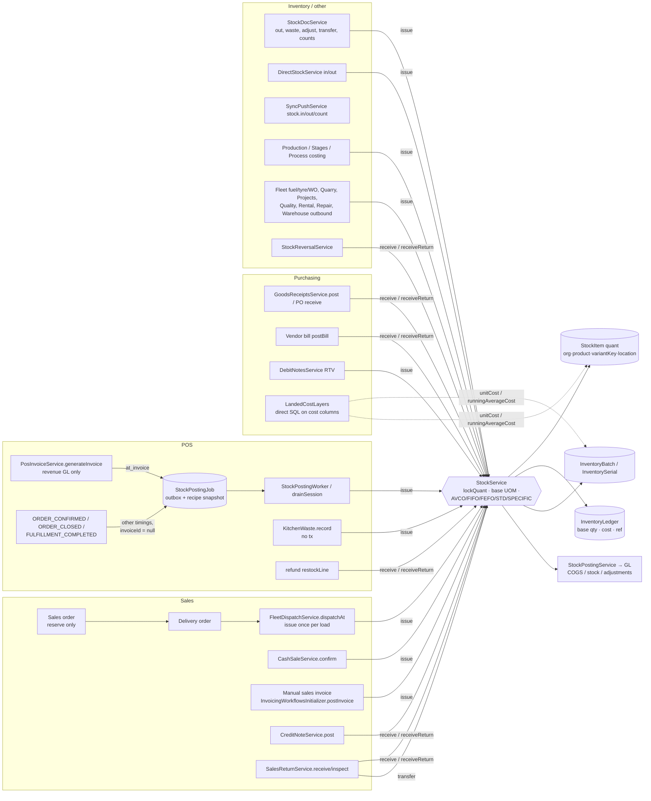

# Sales / Variant / UOM / Inventory integrity audit (Phase I, Step 0)

- Date: 2026-11-15. Read-only audit: no code was changed.
- Plan: `/root/.claude/plans/i-have-this-review-harmonic-reddy.md` (Step 0). The external review that asked for this
  audit is summarised in that plan's Context section.
- Addendum (web UI + Android POS): `2026-11-15-ui-android-addendum.md`.
- Progress: I1a fixed V-1, V-2, V-3 and S-1 (ADR-S072). I1b fixed U-1, U-2, U-3 and A-5 (ADR-S003 addendum). I1c and
  the I-web pass fixed the web findings of the addendum that need no new backend (see `docs/PORT_STATUS.md`).
- Scope: every flow that creates, changes or reverses stock, and how product variants, units of measure (UOM) and
  cost travel through it.

**Labels**
- **C** (confirmed): the code path was read end to end. Findings marked **C\*** were also re-checked by hand while
  writing this report.
- **S** (suspected): inferred from the code but not traced or reproduced. Each S item gets a test that proves or
  disproves it before any fix.
- Nothing here was reproduced by running code. Every C item is proven by reading the code; I1–I5 start each fix with
  a failing test.

**Paths:**
- `J/` = `backend/src/main/java/com/inventoryerp/`
- `T/` = `backend/src/test/java/com/inventoryerp/`
- `M/` = `backend/src/main/resources/db/migration/`

**Parity:**
- These areas have no NestJS counterpart (Spring-only extensions): product units (V5, ADR-S003), product variants
  (V370, ADR-S058) and sizing (V446, ADR-S066).
- These are inherited from Nest unchanged: the POS posting timings, kitchen waste, and the POS issue without a
  variant.
- Fixing an inherited behaviour is a labelled deviation that needs an ADR.

---

## 0. Executive summary

The architecture holds up:
- There is one stock engine (`StockService`). Every mutator is `@Transactional` and locks the quant (advisory lock,
  then the row `FOR UPDATE`).
- Stock and the stock ledger are always in the product's base unit.
- Stock quants, batches, serials and reservations are keyed per (product, variant, location).
- Valuation is computed per quant.
- B2B delivery is the only point where a sales order moves stock, with one issue per load.

The defects are **integration gaps at the edges**, not a broken core. They fall into five groups:

1. **POS does not use product variants.**
   - The stock issue drops the variant, and so does kitchen waste.
   - The price ignores the attribute price extras.
   - Kitchen waste on a plain product issues in the base unit, although the sale issued in the sales unit.
2. **Unit factors are guessed or ignored.**
   - Sales lines silently save a factor of 1.
   - `transfer` and `adjust` ignore the unit. As a result, quarantine on a sales return moves the wrong quantity.
   - Recipe, combo and modifier issues, credit notes and documents derived from other documents re-resolve the factor
     live instead of using the saved one.
3. **The variant's cost and price are bypassed.**
   - Cost fallbacks use the product's cost.
   - Fixed-price pricelists, agreements and promotions override every variant's price.
   - Invoices, the Orders module and Fleet delivery orders never pass the variant to the pricing engine.
   - The pricing engine and ADR-S003 disagree on what `salesPrice` means when the sales unit is not the base unit.
4. **Posting safety outside the main flows.**
   - The POS stock timings other than "at invoice" lose the invoice link, so a restock refund breaks.
   - Invoice and credit-note posting have no lock or compare-and-set.
   - Kitchen waste runs with no transaction and swallows its errors.
   - There is a lock-order inversion (fuel tank) and a lost update (crushing survey).
5. **Traceability.** `InventoryLedger` has no document unit, factor, document quantity or source line id.

---

## 1. Stock movement architecture

Engine baseline (C):
- **Mutators:** `receive` :145, `receiveForDocument` :151, `receiveFromBill` :157, `receiveReturn` :169, `issue` :431,
  `adjust` :785 and `transfer` :917 in `J/inventory/application/StockService.java` are all `@Transactional`.
- **Locking:** each one locks through `lockQuant` :1202, taking the advisory lock `avco:<org>:<product>:<variantKey>:<loc>`
  first and then the `StockItem` row `FOR UPDATE`. `transfer` locks both quants in sorted order (:949-955).
- **No engine-level dedupe.**
  - Every call allocates a new `ledgerCode` (:519), and the issue GL key `inventory:issue:<org>:<ledgerCode>` (:670)
    is unique per move.
  - Receipt, return, adjustment and transfer postings use `postingKey = null` (`StockPostingService` :139, :162, :422,
    :431-437).
  - Protection against a retried caller therefore comes **only** from the caller's state claim or from the
    `@Idempotent` HTTP key.
- **Opening balances:** there is no dedicated stock opening loader (C).
  - Opening quantities go through a count with `countType "opening"` (`InventoryCountService` :244 →
    `postCountVariances`, GL ADJUSTMENT_GAIN) or through direct stock-in.
  - The GL opening (`OpeningBalanceService.post` :91) accepts lines on the inventory account.
  - Doing both counts inventory value twice and credits income (S, a procedure risk).

## 2. Module integration matrix

| Source | Caller → engine | Ledger ref type / id | GL | Duplicate guard | Tx | Reversal |
|---|---|---|---|---|---|---|
| B2B delivery | `FleetDispatchService.dispatchAt` :907 → issue :949 | `fleet_trip` / trip | STOCK_OUT (COGS) | `stockIssuedAt` under trip lock + `@Idempotent` | @Tx | `putBack` :1318 → receiveReturn at issue cost |
| Cash sale | `CashSaleService.confirm` :801 → issue :853 | `cash_sale` / submission | STOCK_OUT | lock + `requireDraft` + `@Idempotent` | @Tx | `voidSale` → receiveReturn :1263 from ledger |
| POS sale | `PosInvoiceService.processStockPostingJob` :1349 → issue :1610/1632/1702/1780 | `pos_invoice`, `pos_invoice_combo`, `menu_recipe`, `pos_invoice_extra` | STOCK_OUT | job `FOR UPDATE` + `postedLineKeys`; enqueue key `trigger:invoice\|order` :235 | TransactionTemplate | refund `restockLine` :1126 |
| POS kitchen waste | `KitchenWaste.record` :37 → issue :117 | `pos_kitchen_waste` / `itemId:qty` | WASTE | ledger count check :64 | **none** | none |
| Manual sales invoice | `InvoicingWorkflowsInitializer.postInvoice` :127 → issue :149 | `sales_invoice` / doc | STOCK_OUT; revenue JE key null | status read, **no lock/CAS** | @Tx (WorkflowService) | `returnIssuedStock` :204 |
| Vendor bill | `postBill` :278 → receiveFromBill :450 | `vendor_bill` / bill | Dr stock / Cr GRNI, key `vendor_bill:<id>` | workflow status | @Tx | bill cancel (not traced) |
| Credit note | `CreditNoteService.post` :305 → receiveReturn :379 | `credit_note` / id | restock; JE key null | status read, **no lock** :315 | @Tx | none |
| Sales return | `SalesReturnService.receive` :204 → receiveReturn :232; `inspect` → issue :290/:305, transfer :302 | `sales_return` / id; **transfer has no source** | restock / WASTE / STOCK_OUT | `lock()` :457 + status + `@Idempotent` | @Tx | none |
| Goods receipt | `GoodsReceiptsService.post` :259 → receiveForDocument :365 | `goods_receipt` / grn | Dr stock / Cr GRNI + voucher | CAS `status='draft'` :311 | tx.execute | `reverse` :411 → `StockReversalService` |
| PO receive | `PurchaseOrdersService` → receiveForDocument :741 | `goods_receipt` / new grn | same | new GRN per call: **`@Idempotent` only** | tx.execute | GRN reverse |
| Debit note (return to vendor) | `DebitNotesService.postSupplierReturn` :372 → issue :399 (skipGl) | `debit_note` / id | own JE `debit_note_rtv:<id>` | `markPosted` CAS :356 | tx.execute | none |
| Direct stock | `DirectStockService.directIn` :84 / `directOut` :132 | `direct_stock_in/out` | gain / issue | `@Idempotent(required)`, sync opId | @Tx | none |
| Stock documents | `StockDocService` out :198, waste :296, adjust :619, count variances :678, transfer :785/:876/:953-964/:1016 | `stock_out`, `waste`, `stock_adjustment`, `stock_transfer*` | per type | `claim()` CAS / `lockTransfer` + `@Idempotent` | @Tx | `StockReversalService.reverseDocument` :80 |
| Counts / sync / beverage | `InventoryCountService.submit` :677; `SyncPushService` `stock.count` :937 (**3 separate tx**) | `stock_adjustment` | ADJUSTMENT_GAIN/LOSS | session CAS :733; opId | per call | adjustment reverse |
| Warehouse outbound | `WarehouseOutboundService.issueShipped` :387 → issue :406 | `WarehousePickOrder` / code | STOCK_OUT | order lock + status | @Tx | cancel (not traced) |
| Production | `ProductionService` start → issue :392; QC :623/:627; reverse :767; output :855; return :884 | `production_*` | consume / output (key null) | `lock(id)` + status | @Tx | `reverseOrder` / cancel |
| Stages / process costing | `StageExecutionService` :310/:635; `ProcessCosting` :256/:353 | `production_stage`, `process_costing` | explicit | `@Idempotent` + advisory lock / period lock | @Tx | `reversePosting` :746 |
| Quarry / crushing | `CrushingSurveyService` adjust :230; Explosive :487/:557; Stockpile :121; Extraction :319 | survey / extraction ids | own JEs | row lock + status | @Tx | opposite adjust / reverseLedgerSource |
| Fleet other | fuel :106/:417, work-order parts :131/:175/:309, tyre :531 | `fleet_*` | own JEs with keys | `stockIssuedAt` / status | mixed | reverseLedgerSource |
| Projects, quality, distribution, rental, repair | `ProjectCost` :130/:361, `QualityDecision` :129-291, `DistributionCosting` :355, `RentalPosting` :91, `RepairParts` :106 | various | issue or own JE | locks + status | @Tx / inTx | partial |
| Landed cost | `LandedCostLayers` (direct SQL) | value-only rows via `CostLineageService.recordValueOnly` | `inventory:landed_cost:<org>:<id>` | key | caller tx | voucher reversal |

**Direct writes outside `StockService` (C):**
- `LandedCostLayers` (procurement) updates `InventoryBatch.unitCost`, `InventorySerial.unitCost` and
  `StockItem.runningAverageCost`. It does not write quantities.
  - On the AVCO path it copies the engine's advisory-lock key string (:615, :714).
  - The lot and serial paths take no advisory lock.
  - It is a module-boundary breach: procurement owns inventory valuation SQL.
- Inside the inventory module: `CostLineageService` :136, `InventoryRevaluationService` :375/:379,
  `StandardCostService.revalueOnHand` :441-451 (row locks, no advisory lock), `InventoryCostPolicyService` :409-435,
  `LineageFollower` :404.
- Seeds insert `opening_balance` rows with no GL.

---

## 3. Variant integrity matrix

`ProductVariantService.resolve/find` (which validates owner, active flag and deletion) is called only by the PO,
goods receipt, sales order, quotation, cash sale and the pricing engine.

Every other flow relies on `StockService.requireVariant` (:408-426). That check:
- does **not** check `isActive`;
- lets a variant product move **without** a variant whenever a quant with no variant exists at that location (:423).

| Flow | Carries variantId | Validated | Priced from variant | Costed from variant | Stock move has variant | Gap |
|---|---|---|---|---|---|---|
| Purchase request | yes `PurchaseRequestsService` :136 | **no** | – | – | n/a | V-7 |
| PO / goods receipt | yes | resolve (`PurchaseOrdersService` :240, `GoodsReceiptsService` :200) | manual | per quant | yes (:357, :737) | – |
| Vendor bill | yes | only when given (`DocumentBuilderService` :350) | default = variant **sales** price for a purchase line (:364) | – | yes | V-8 |
| Landed cost | yes, per product·variant·location·lot | – | – | per variant | – | GL `targets` key drops variant (cosmetic) |
| Quotation / sales order | yes | resolve | engine + variant | variant cost (`SalesOrderService.costOf` :667) | via fleet | – |
| ATP / reservation | yes, variantKey | – | – | – | – | – |
| Delivery from sales order | yes (`FleetDeliveryOrderService` :321) | – | – | – | yes (`FleetDispatchService` :943) | – |
| Manual delivery order | **no** (`FleetDeliveryOrderService` :265 passes null) | – | – | – | no | V-6 |
| Sales invoice | yes | `DocumentBuilderService` :343-366 (no hasVariants or isActive check) | builder default = PRICE_SQL; a fixed pricelist price overrides it | – | yes (:146) | V-5, P-1 |
| Credit note | yes, or inferred from invoice (:246-252) | no | copied | current cost, product fallback | yes (:380) | U-6 |
| Cash sale | yes | resolve (:583) | engine + variant | variant cost | yes (:854, :1264) | – |
| Sales return | yes | no | – | issue cost | yes | – |
| **POS sale** | yes | only the `salesPrice` row check | **priceExtra ignored** C\* (`PosOrdersService` :1011-1022) | – | **no** C\* (`PosInvoiceService` :1624) | **V-1, V-2** |
| POS refund | from ledger (:1158-1191) | – | – | ledger cost | yes, so it **misses** the variant-less issue | V-1 |
| Kitchen waste | **no** C\* (`KitchenWaste` :108) | – | – | – | no | V-3 |
| Server count | yes (parent expands to variants, `InventoryCountService` :346-412) | – | – | per quant | yes | – |
| Device count | **409** for variant products C (`SyncPushService` :954-962) | – | – | – | – | V-4 |
| Transfer / adjustment | yes | requireVariant | – | adjustment: product cost fallback (:822, :879) | yes | C-1 |
| BOM / production | yes (outputVariantKey) | **none** (`BomService.create` :118-138, `ProductionService` :140-200) | – | output = consumed | yes; **substitute drops variant** (:388) | V-9 |
| Reorder / replenishment | – | – | – | product cost (`InventoryReportsService` :752) | – | sums per **product** (`InventoryQueryService` :492, `ReplenishmentService` :361) V-10 |
| Repair, project, process costing, tyre, quarry issues | **no** | – | – | – | no | V-11 (these products rarely have variants) |

**Web client:** sends `variantId` on PO, quotation, sales order, cash sale, invoice, count and POS. It does not send
it on purchase request, goods receipt, transfer, adjustment, BOM/production, manual delivery order, credit note or
return screens.

---

## 4. Pricing precedence

**`SalesPricingEngine.price`** (`J/sales/application/SalesPricingEngine.java` :193-260):
1. If a variant is given, it swaps in the variant's list price (`PRICE_SQL = COALESCE(v.salesPrice, p.salesPrice +
   v.priceExtra)`) and its cost (`COST_SQL`) (:203-216). This checks `deletedAt` only, not `isActive`.
2. It scales the price by the unit: `list = salesPrice × factorToBase(uomId)` (:218) C\*.
3. Tiers, where the first hit wins:
   1. agreement
   2. promotion (skipped through `quote()`, :238)
   3. customer_rule
   4. crm_rule
   5. customer_pricelist
   6. category_pricelist
   7. price_list
   8. branch_default
   9. org_default
   10. standing_discount
   11. list
- **Fixed** tiers match on product only, so one fixed price applies to every variant (P-1, C): agreement :311,
  promotion `fixed_price` :291, pricelist `fixed` :554, CRM :341, named list :355.
- **Percentage** tiers apply on top of the variant's list price.

| Channel | Fixed variant price | priceExtra | Pricelist | Agreement | Promotion | Order actually applied |
|---|---|---|---|---|---|---|
| Sales order / quotation | ✔ | ✔ | ✔ (fixed overrides variant) | ✔ | ✔ | full engine |
| Quotation approval re-check (`SalesQuotationService` :604-614) | ✔ | ✔ | partial | **✘** | ✔ | re-priced with **uomId, branch, site = null** → P-4 |
| Cash sale | ✔ | ✔ | ✔ (no branch default) | ✘ | ✔ | engine |
| Invoice (`InvoiceService.priced` :441-454) | builder default | ✔ | ✔ **without variant** | ✘ | ✘ | list price > ProductUom price > variant price > product price |
| Orders module (`OrdersService` :604-622) | ✘ | ✘ | ✔ | ✘ | ✘ | list > product |
| Fleet manual delivery order (:257-266) | ✘ | ✘ | ✔ | ✘ | ✘ | list > `product.salesPrice` **not scaled by the unit** (P-5) |
| POS (`PosOrdersService.resolveLines` :992-1033) | ✔ | **✘** | ✘ | ✘ | ✘ | variant `salesPrice` or catalogue + modifiers + accompaniments |

**P-2. Meaning of `salesPrice` (C\*).**
- `SalesPricingEngine` :218 multiplies `salesPrice` by the unit's factor to base. It therefore treats `salesPrice` as
  the price **per base unit**.
- ADR-S003 (:38-39), `UomConversionService.defaultUnitPrice` :335-355 and POS treat it as the price **per sales
  unit**.
- They agree only when the product's sales unit is its base unit.
- Example: base = piece, sales unit = box of 24, salesPrice = 240 per box. A sales order line of 1 box is quoted at
  240 × 24 = 5,760.
- **This needs an owner decision (D1).**

**P-3. Unit price beats variant price.** `defaultUnitPrice` returns `ProductUom.salePrice` ahead of the variant price
(:345-349). A variant sold in another unit loses its variant price.

---

## 5. UOM conversion matrix

The engine is `J/core/application/UomConversionService.java`:
- `convert` :107 rounds to the target unit's precision and throws a 400 "No conversion from X to Y…" (:141).
- `resolveLineUnit` :296 throws a 400 for a unit that is inactive or not enabled for the role.
- `StockService.toBaseQtyCost` :1152 prefers the saved factor and preserves total value. A factor of exactly 1 skips
  conversion and ignores `uomId` (:1156) C\*.
- `DocumentBuilderService.LineInput` (:60) **has no `uomFactor`**, so every document built from another one
  re-resolves the factor live (U-5). This covers credit notes, cash sale → invoice (`CashSaleService` :1163) and Fleet
  delivery order → invoice (`FleetDeliveryInvoiceService` :135).

| Flow | Document unit | Factor saved | When conversion is missing | Note |
|---|---|---|---|---|
| PO line / goods receipt | `unitOfMeasureId` / copied | yes | 400 | pre-V5 lines use the live `purchaseUomId` |
| Vendor bill | `DocumentLine.uomId` | yes, or **null if an implicit unit fails** | live at post (may 400); bill↔receipt matcher uses **ratio 1** (`BillReceiptMatcherService` :75-76) | U-2 |
| Quotation line | `uomId` | **no** (DB default 1, `SalesQuotationService` :502) | silent 1 | U-1 |
| Sales order line | `uomId` | **silent 1** C\* (`SalesOrderService` :643; `lineUnit` swallows the 400 :306-314) | silent 1 | U-1 |
| Cash sale | `uomId` | **silent 1** (`CashSaleService` :618) | silent 1 | U-1 |
| Delivery order + dispatch | `uomId` | yes (sales order / invoice factor, else live) | 400 (manual) or inherits the silent 1 | – |
| Sales invoice | `uomId` | yes, or null | live at issue | U-2 |
| Credit note | `uomId` | **re-resolved live** (`CreditNoteService` :379-381) | 400 | U-6 |
| Sales return / inspection | sales order line | from the sales order | – | **the quarantine/damaged transfer ignores the unit** C\* (U-3) |
| POS invoice item | `uomId`/`uomFactor` | yes, or null → live `salesUomId` | failure recorded, sale kept | – |
| POS recipe / combo / modifier | `MenuProduct.uomId` / `salesUomId` / `consumptionUomId` | **no factor** (snapshot keeps only the unit id, :244-266) | failure recorded | U-4; modifier maths in `double` |
| Kitchen waste | recipe unit; **plain product = null (base)** C\* | no | `log.warn`, swallowed | V-3 / U-7; `double` maths |
| POS refund restock | base qty from snapshot / ledger | n/a | 400 "missing or ambiguous" | – |
| Orders module | `OrderLineEntryUnit` (V60) | yes | 400 | price rounded to scale 6, not the unit's precision |
| Stock adjustment | none | no | **unit ignored** (`StockService.adjust` :785-830) | U-3 |
| Transfer | `uomId` on the DTO | no | **unit ignored** C\* (:917-960) | U-3 |
| Counts (server) | base | – | – | – |
| Production consume / output / stages | material / order unit | no (live `toBase`) | 400 | yield variance mixes document qty with base cost (S, :534) |
| Production substitute | **set to null** (`ProductionService` :376-404) | no | silent: substitute base unit | U-8 |
| Reorder suggestions | `purchaseUomId` / legacy `uomConversion` | – | **400 for the whole report** (`InventoryQueryService` :505-516) | U-9 |

**Other UOM findings:**
- `Product.recipeUomId` and `productionUomId` are never read (C).
- The `stock.issued` event's `quantity` is in document units, not base (S, `StockService` :680).
- **Sizing (ADR-S066) and units (U-10, C).**
  - `ProductSizingService.compute` :211-235 always returns m / m² / m³.
  - `save` :121 does not check that the product's unit is in that category.
  - `DocumentBuilderService` :367-376 applies the line unit's factor to the sized quantity. So a sized product sold
    in a BOX sales unit, or with an explicit `cm` unit, is scaled twice.

---

## 6. Costing and valuation

| Method | Receipt | Issue | Per variant |
|---|---|---|---|
| AVCO | `CostResolver.resolveReceiptCost` :114-138; average per quant (`StockService` :289-298) | quant `runningAverageCost` (:648-651) | quant ✔; **fallback = product cost** (:475-477, :1232) |
| FIFO / FEFO | `InventoryBatch` with variantId (:305-311) | `consumeBatches`; overflow uses consumed average, else product cost (:631-633) | lots filtered by variant ✔ |
| STANDARD | `StandardCostService.activeStandard(productId)` (:257-259), price variance | product `costPrice` (`CostResolver` :78-80) | **per product by design** (D3) |
| SPECIFIC | serial `unitCost` (:336-346) | serial cost; overflow and non-serial use product cost (:564, :582; `CostResolver` :90) | serials per variant ✔ |

- **Mixed UOM costing is correct where a factor exists (C).**
  - `toBaseQtyCost` divides unit cost by the factor.
  - `receiveReturn` converts quantity, and its callers pass a per-base cost (`SalesReturnService` :246-254, fleet
    `putBack`, cash-sale void, invoice cancel).
- **Wrong return costs.** These use today's average, the live factor and the product's (not the variant's) fallback
  (U-6, C-1):
  - credit notes;
  - sales returns not delivered by Fleet.
- **Valuation (C).**
  - `InventoryValuationService.currentValueByQuant` (:170-205) values per quant, so the review's example (variant 1:
    100 × $5 + variant 2: 100 × $8 = $1,300) comes out right for AVCO, FIFO and SPECIFIC.
  - STANDARD uses `qty × product.costPrice`.
  - When the average is 0 it falls back to product cost instead of `COST_SQL`.
- **C-2. Item list and item detail value stock wrongly (C).**
  - `InventoryQueryService.mapProduct` (:197-210) and `getItemDetail` (:256-259) compute `qty × runningAverageCost`
    whatever the costing method.
  - FIFO and STANDARD receipts never set that average (`CostResolver` :136), so those products show a value near
    zero.
  - The movement report (`InventoryReportsService` :322-368) has the same problem.
  - The `mapProduct` stock query has no `organizationId` filter. It is scoped by product UUID, so this is hygiene,
    not a leak (C\*).
- **Negative-stock true-up:** computed per quant; posted to the GL per product; fallback is product cost (C).
- **Landed cost:** spread per (product, variant, location, lot) (C). For the locking gap see A-6.

---

## 7. Defects

### Confirmed (C; C\* = re-checked by hand for this report)

| ID | Defect | Evidence | Impact |
|---|---|---|---|
| V-1 | POS plain-product issue drops `variantId`; a restock refund then can't find the issue | `PosInvoiceService` :1624-1632 C\*, :1158 | Variant products fail to post, or drain a quant with no variant; refunds 400 |
| V-2 | POS ignores `priceExtra` | `PosOrdersService` :1011-1022 C\*; `ProductVariantService` :38 | Wrong POS price |
| V-3 | Kitchen waste: no variant; plain product wasted in base unit; errors swallowed; no tx; `double` maths | `KitchenWaste` :88-123 C\* | Wrong or lost waste quantity |
| U-1 | Sales order / cash sale / quotation save factor 1 when the unit doesn't resolve | `SalesOrderService` :643 C\*, `CashSaleService` :618, `SalesQuotationService` :502, `DocumentBuilderService` :306-314 | Stock moved 1:1 in the wrong unit |
| U-2 | Vendor bill / invoice keep no factor when an implicit unit fails; bill↔receipt matcher uses ratio 1 | `DocumentBuilderService` :306; `BillReceiptMatcherService` :75-76 | Mismatched three-way match |
| U-3 | `transfer` and `adjust` ignore the unit; sales return quarantine/damaged moves N line units as N base units | `StockService` :785, :917-960 C\*; `SalesReturnService` :298-302 C\* | **Wrong quantity in quarantine** (2 boxes of 12 → 24 received, 2 moved) |
| U-4 | Recipe / combo / modifier issue without a saved factor | `PosInvoiceService` :244-266, :1694-1786 | A later unit change rewrites the meaning of a retried posting |
| U-5 | `LineInput` has no factor; derived documents re-resolve it live | `DocumentBuilderService` :60; `CashSaleService` :1163; `FleetDeliveryInvoiceService` :135 | Factor drift between documents |
| U-6 | Credit note restocks at current average with the live factor | `CreditNoteService` :379-381 | Wrong restock value and quantity after a pack-size change |
| U-8 | Production substitute consumed in its base unit | `ProductionService` :376-404 | Wrong consumption |
| U-9 | Reorder report fails entirely if one product's unit can't convert | `InventoryQueryService` :505-516 | Report unavailable |
| U-10 | Sized product + non-metric unit → double scaling | `ProductSizingService` :121, :211-235; `DocumentBuilderService` :367-376 | Wrong quantity on sized lines |
| P-1 | Fixed pricelist / agreement / promotion / CRM rules override every variant price; invoice, Orders, manual delivery order don't pass the variant | `SalesPricingEngine` :291-355, `PriceListService` :41, `InvoiceService` :450 | Same price for all variants |
| P-2 | Engine treats `salesPrice` as per base unit; ADR-S003, builder and POS treat it as per sales unit | `SalesPricingEngine` :218 C\*; `UomConversionService` :335-355 C\* | Prices × factor when sales unit ≠ base |
| P-3 | `ProductUom.salePrice` beats the variant price | `UomConversionService` :345-349 | Variant price lost in other units |
| P-5 | Manual delivery order price not scaled by the unit | `FleetDeliveryOrderService` :263-264 | Wrong price |
| V-4 | Device counts return 409 for variant products | `SyncPushService` :954-962 | Can't count variants on device |
| V-5..V-9 | No variant validation: invoice builder, credit note, purchase request, debit note, BOM/production; `requireVariant` has no `isActive` check and a legacy escape hatch | see §3 | Variant products move without a variant |
| V-10 | Reorder and replenishment aggregate per product | `InventoryQueryService` :492; `ReplenishmentService` :361 | Wrong reorder for variants |
| C-1 | Cost fallbacks use product cost, not variant cost | `StockService` :212, :477, :564, :582, :633, :805, :822, :879, :1232; valuation :179/:189 | Wrong first-issue / count / return cost for variants |
| C-2 | Item list / detail / movement report value FIFO & STANDARD wrongly | `InventoryQueryService` :197-259; `InventoryReportsService` :322-368 | Misleading stock value on screen |
| T-1 | POS stock timings other than "at invoice" queue the job without an invoice: no register location, no saved unit, no snapshots, `sourceId` null, reservations never consumed; restock refund 400s; the pending-job guard misses the job | `PosEventSubscribers` :32-63 C\*; `PosInvoiceService` :233, :1488-1520 C\*, :1085-1090 C\* | Refunds break; stock posted at the wrong location. Inherited from Nest |
| A-1 | Invoice post and credit-note post: no lock / CAS on the status transition | `WorkflowService.transition` :98, :246; `CreditNoteService` :315 | Concurrent posts could double-issue (S that it happens) |
| A-2 | Crushing survey posts an absolute count read without a lock | `CrushingSurveyService` :217-230 | Lost update |
| A-3 | Fuel tank: row lock first, then advisory lock (opposite order to `issue`) | `FleetFuelTankService` :478 | Deadlock possible |
| A-4 | Missing `organizationId` filter (UUID-scoped, hygiene) | `InvoicingWorkflowsInitializer.returnIssuedStock` :205-210 C\*; `InventoryQueryService` :197 | Hard-rule breach |
| A-5 | Return quarantine transfer has no source on its ledger row | `SalesReturnService` :299-302 | Untraceable |
| R-1 | `InventoryLedger` has no document unit, factor, document qty or source line | `M/V1__baseline.sql` :5259 C\* | Audit trail incomplete (review requirement) |

### Suspected (S) — prove with a test first

| ID | Suspicion | Evidence |
|---|---|---|
| S-1 | **POS per-line tolerance may not work.** `Savepoints.run` wraps `stock.issue`, which is `@Transactional` (REQUIRED). A throw marks the job's outer transaction rollback-only, and nothing sets `globalRollbackOnParticipationFailure=false`. The commit would then throw `UnexpectedRollbackException`, rolling back the good lines and the job state. The existing F-COGS test fails before `stock.issue` is called, so it doesn't cover this. | `J/kernel/common/Savepoints.java`; `PosInvoiceService` :1536-1564 |
| S-2 | Multi-line documents lock quants in line order: cash sale, invoice post, goods receipt, dispatch, POS job. Two documents with opposite line orders could deadlock. | `CashSaleService` :849 etc. (StockDocService, WarehouseOutbound and StockReversal do sort) |
| S-3 | Landed-cost lot/serial paths take no advisory lock while `StockService.lots()` reads without `FOR UPDATE`, so value can drift. | `LandedCostLayers` :246, :460, :534; `StockService` :1292 |
| S-4 | Production reversal: the GL uses output cost, but stock is issued at current cost. | `ProductionService` :758, :767 |
| S-5 | Sync `stock.count` runs as 3 separate transactions; a failed submit leaves an open count behind. | `SyncPushService` :937 |
| S-6 | Rental swap: return transfer uses qty 1, checkout uses the line qty. | `RentalSwapService` :102-103 |
| S-7 | Quotation approval re-pricing (no unit, no agreement) can hide or invent a discount. | `SalesQuotationService` :604-614 |
| S-8 | Opening stock by count + GL opening balance counts value twice. | `InventoryCountService` :244; `OpeningBalanceService` :91 |

---

## 8. Existing tests and gaps

**Reuse these:**
- `T/ApiTestSupport` (`call`, `as`, `pinPosWarehouse`, `drainOutboxFully`)
- `T/procurement/ProductUnitsIT` (`unit`, `unitRow`, `setUnits`, `createPo`, `receiveAll`, `onHand`, `avgCost`)
- `T/core/ProductVariantIT` (`fixtures`, `product`, `configure`, `byName`)
- `T/pos/PosStockPostingIT` (`stockProduct`, `job`)
- `T/accounting/support/LedgerInvariants` (`inventoryTiesOut`, `postingComplete`)
- `T/manufacturing/MfgTestSupport`, `T/fleet/FleetWeighDispatchSupport`

**Already covered (no new work needed beyond regression):**
- partial deliveries (`SalesDeliveryIT` 40+35+25 t, `SalesWeighbridgeIT`, `SalesFulfilmentIT`)
- partial invoicing (`SalesBillingIT` D5)
- cash sale → invoice (`CashSaleIT` T14-T21)
- returns (`SalesReturnFlowIT`, `SalesReturnIT`)
- idempotent replay (`SyncInventoryReplayIT`, `PosStockPostingIT` exactly-once, `CashSaleIT` T13, `Acc0IdempotencyIT`)
- concurrency (`StockConcurrencyIT`)
- tie-out (`InventoryValuationReportIT`, `InventoryHardeningIT`)
- UOM purchase side (`ProductUnitsIT`, `ProductDensityIT`, `OrdersUnitsIT`)

**Missing tests (none found):**

| Test | Defect |
|---|---|
| POS product variant: sale issues from the variant quant; refund restocks the same variant | V-1 |
| POS variant priced as base + priceExtra | V-2 |
| Kitchen waste for a variant product and a product sold in a pack | V-3 |
| Sales order / cash sale / quotation with an unresolvable unit → 400, nothing written | U-1 |
| Bill↔receipt match when one side has no factor | U-2 |
| Adjustment and transfer in a non-base unit; return quarantine with Box(12) | U-3 |
| Unit factor changed between checkout and drain (recipe, combo, modifier) | U-4 |
| Credit note after a pack-size change | U-5/U-6 |
| Sized product with a non-metric sales unit | U-10 |
| Variant-specific pricelist price; product-level rule over variants | P-1 |
| Sales order line in BOX where salesUomId = BOX | P-2 |
| Variant first-issue / count / credit-note cost uses variant cost | C-1 |
| FIFO / STANDARD item list value | C-2 |
| Device `stock.count` for a variant product | V-4 |
| `at_confirmation` / `at_payment` / `at_fulfillment_complete` posting + restock refund | T-1 |
| Concurrent invoice post / credit-note post | A-1 |
| POS job where `stock.issue` throws on one line (stockPolicy=block) while other lines succeed | S-1 |
| `StockItem.quantity` = Σ ledger per variant quant; parallel POS drains on one variant quant | reconciliation |
| Reorder suggestions with purchase unit; substitute unit | U-8/U-9 |

---

## 9. Owner decisions needed

1. **D1: meaning of `Product.salesPrice` when the sales unit ≠ base unit (P-2).**
   - Recommendation: price **per sales unit**, as ADR-S003 says. Change the engine to divide by the sales unit's factor
     (`defaultUnitPrice` logic) and use the `ProductUom.salePrice` override.
   - Affects quotation, sales order and cash-sale prices for those products.
   - Today only products with `salesUomId ≠ uomId` are affected.
2. **D2: the `requireVariant` escape hatch.** Recommendation:
   - keep accepting the legacy no-variant quant for *issues* until it is used up;
   - refuse new *receipts* without a variant;
   - add the `isActive` check.
3. **D3: STANDARD cost per variant.**
   - Recommendation: keep it per product now; record it as a known limit in ADR-S058.
   - Separately, use `COST_SQL` for the non-standard fallbacks (C-1).
4. **D4: Nest-inherited deviations.** These deviate from Nest; each goes in ADR-S072 and the module's Deviations
   section:
   - POS variant-aware issue (V-1);
   - kitchen waste in a transaction, with failures recorded as `InventoryException` instead of swallowed (V-3);
   - linking the job for the other POS timings to the invoice (T-1).
5. **D5: Opening stock procedure (S-8).**
   - Recommendation: document "quantities via an opening count; no inventory-account lines in the GL opening
     balance".
   - Optionally add a guard in `OpeningBalanceService`.

---

### 9.1 Owner decisions (2026-11-15) — all approved

**D1: APPROVED. `salesPrice` is the price per default sales unit (ADR-S003).**
- `Product.salesPrice` is the price per default sales unit.
- `ProductUom.salePrice` overrides it for that unit.
- An already-defined sales-unit price is never multiplied by the conversion factor.
- Variant prices take precedence over the parent product's default price.
- Customer-specific pricing resolves the same way across POS, quotations, orders and invoices.
- Every document saves the unit price and unit it actually used.
- The pricing ADR records D1 before the pricing work starts.
- Historical invoice values must not change.

**D2: APPROVED. Variant identity is enforced for products with variants.**
- New receipts must name a valid, active variant.
- Legacy stock with no variant may be sold until it runs out.
- Inactive variants cannot receive stock or be used in new transactions.
- Historical transactions stay readable.
- The parent product is never silently used in place of a missing variant.
- Products without variants keep working as before.

**D3: APPROVED. STANDARD costing stays per product.**
- FIFO and AVCO keep their per-variant costing; SPECIFIC keeps its own cost layers.
- STANDARD uses the product's configured standard cost.
- Reports value stock by the actual costing method, not by an average field that may be zero.
- The limit is recorded in the costing ADR.

**D4: APPROVED. Three deviations from Nest, recorded in ADR-S072 with regression tests:**
1. POS variant stock issue.
2. Kitchen-waste handling.
3. POS posting timing and refund integration.

Accounting and inventory must stay consistent.

**D5: APPROVED WITH CONDITION. Opening stock quantities enter only through an approved opening count.**
- Inventory asset amounts are not entered separately in the GL opening balance.
- The opening count sets both quantities and valuation.
- The count's GL posting must credit an opening-balance equity or migration clearing account. The general
  stock-adjustment income account is not acceptable.
- Today the count posts ADJUSTMENT_GAIN, so this is a change (scheduled in I5).
- Reconciliation must prove that the inventory subledger value equals the GL inventory control account.

**Additional requirements:**
- **R-A: Ledger traceability.** Every stock movement records:
  - source module, source document id and source line id;
  - original quantity, original unit and conversion factor;
  - base quantity, variant and cost snapshot.
- **R-B: POS line atomicity.** The test is: line 1 ✔, line 2 ✔, line 3 ✘, line 4 ✔. Expected result:
  - lines 1, 2 and 4 are posted and committed, and stay posted;
  - line 3 is recorded as a retryable `InventoryException`;
  - the job stays retryable;
  - a retry issues only line 3, never lines 1, 2 or 4 again;
  - the invoice shows which lines were posted (the job's `postedLineKeys` plus the per-line ledger / snapshot rows).
- **R-C: Concurrency.** Two simultaneous posts of the same invoice or credit note must never create duplicate stock
  moves or duplicate journals. This is enforced by database locking and idempotency, not by the UI.
- **R-D: Snapshots.** Historical prices and conversion factors are kept when product setup changes.

**Execution order (owner):**

| Order | Phase | Work |
|---|---|---|
| 1 | I0 | this audit and these decisions |
| 2 | I1a | POS variant stock issue and price, kitchen waste, the S-1/R-B rollback test |
| 3 | I1b | unit validation, transfers, adjustments |
| 4 | I2 | costing, valuation and ledger traceability (R-1/R-A) |
| 5 | I3 | variant pricing and price-list consistency |
| 6 | I4 | sales pricing meaning (D1) and cross-module consistency |
| 7 | I5 | integration and regression testing, posting concurrency (R-C), opening stock (D5) |

Each phase is a separate change with a report (tests run, files changed) before the next one starts. The existing
architecture is kept unless a demonstrated defect requires a change.

## 10. Updated roadmap (superseded in order by §9.1; contents still apply)

This changes the roadmap in the plan:
- U-3 (transfer/adjust unit, which causes the wrong quarantine quantity) and S-1 (POS per-line tolerance) move **into
  I1**.
- Pricing D1 is decided before I4.

| PR | Contents | Depends on |
|---|---|---|
| **I1a: POS integrity** | V-1, V-2, V-3, and a test that proves or disproves S-1 (fix it here if it is real); ADR-S072 (D4) | – |
| **I1b: unit strictness** | U-1 (reject instead of saving 1; base-unit lines still 1), U-2 matcher, U-3 (`adjust`/`transfer` use `toBaseQtyCost`; return quarantine; A-5 source) | – |
| **I2: variant cost and counts** | C-1 (`COST_SQL` fallbacks), C-2 (value by costing method), V-4 device counts, V-5..V-9 validation + D2, V-10 reorder per variant | I1 |
| **I3: unit snapshots and traceability** | U-4 (factor into `recipeSnapshot`), U-5 (`LineInput.uomFactor` carried through derived documents), U-6 (credit note at issue cost and saved factor), U-8, U-9 (skip and flag instead of failing the report), U-10 (unit category check for sized products), R-1 (`V486__inventory_ledger_traceability.sql`: nullable `sourceLineId`, `docQuantity`, `docUomId`, `uomFactor`), `stock.issued` event in base qty | I1b |
| **I4: pricing** | D1/P-2, P-3, P-1 (`PriceQuery.variantId`; optional `variantId` on pricelist/agreement/promotion lines), P-5, S-7, Orders module variant; ADR-S058 addendum with the precedence order | D1 |
| **I5: posting integrity** | T-1 (+ restock guard by order), A-1 (CAS on invoice / credit-note post), A-2 (delta count), A-3 (lock order), A-4 hygiene, S-2..S-6 each proven first then fixed, S-3 moves landed-cost cost writes behind an inventory API (module boundary), D5 doc, reconciliation ITs | I1–I3 |

Then Phase A resumes at A2. The owner may choose to resume after I2 instead.

**Not in scope:**
- per-grade or per-moisture density (the factor saved on each line already freezes it per transaction);
- weighbridge measured weight beating estimated volume (Phase A3/A4);
- variants on menu recipe ingredients (`MenuProduct` has no variantId);
- the unused `recipeUomId` / `productionUomId`.
