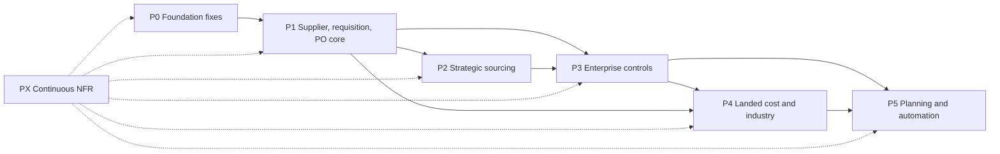

# Procurement modernization roadmap: Enterprise Source-to-Pay

- Status: **proposed** (2026-10-30). Decision: [ADR-PROCUREMENT-001](../adr/ADR-PROCUREMENT-001.md).
- Evidence: [current-state audit](../audit/procurement-current-state-audit.md).
- Effort sizes follow `docs/ROADMAP.md`: S ≤ 2 engineer-weeks (EW), M 3–6 EW, L 7–12 EW (±50 %).
- Every PR follows `AGENTS.md` §6–7: `./gradlew build` green, authorization and tenancy ITs, parity allowed-diffs for
  any changed parity behaviour, `docs/PORT_STATUS.md` extension rows, and coverage ≥ 80 % on `procurement.application`.
- Branches: `phase/S2P-<phase>-<area>`, one concern per PR.
- Migrations: next free `V{n}` (V26 as of today). Worktrees use V9xx until merged (BUILD_LOG Track C).

## Recommendation: CONDITIONAL GO

Start **P0 now**. P1 starts when every P0 acceptance IT is green **and** the owner has answered OD-1 to OD-7
(`docs/DECISIONS_FOR_OWNER.md`). P2 to P5 do not start before P1 exits.

## Release map

| Release | Phases | Outcome |
|---|---|---|
| R1 | P0 + P1 | Core purchasing is financially reliable |
| R2 | P2 + P3 | Competitive sourcing and governance |
| R3 | P4 | Construction-materials ready |
| R4 | P5 | Automated supply planning |

---

## P0: Transactional foundation (M, about 4 EW)

Each item is a `fix(<module>)!: … (post-parity)` commit with a Deviations entry in `docs/spec/procurement.md`, an
`allowed-diffs.json` line where JSON or GL rows change, and an IT that fails before the fix.

| # | Item | Module | Effort | Acceptance IT |
|---|---|---|---|---|
| P0-1 | Receipt voucher at actual value for STANDARD products | procurement + inventory | S | STANDARD 100 / PO 110 × 10 → GRNI net 0, AP 1,100, PPV 100 (PO receive, GRN post, cash PO) |
| P0-2 | Block PO delete once any GRN exists; status `draft` only | procurement | S | Delete after partial receipt → 400; bill after receipt credits AP once |
| P0-3 | Debit-note post: claim `WHERE status='draft'` inside the tx; required idempotency | procurement | S | 2 parallel posts → one succeeds, stock issued once |
| P0-4 | Single payment engine: PO `pay` and cash settlement become adapters over `PaymentService`; block pay on draft or rejected POs; advance if no bill | invoicing + procurement | M | Pay credit PO → `Payment` + allocation, residual reduced, WHT applied, approval enforced; JSON unchanged |
| P0-5 | Currency on receipt, voucher and payment; realized FX | inventory + invoicing + accounting | M | USD PO at r1/r2/r3 → stock in UGX at r1, FX gain/loss = (r3 − r2) × amount |
| P0-6 | Org checks on `requestId`, `branchId`, `purchaseOrderId`, `partnerId`; org-filtered `findOne` joins | procurement | S | Cross-org ids → 400 / null; `tenantIsolation` extended |
| B1 / B2 / B6 / B7 | Parity bugs (already planned in phase-A §5) | procurement / invoicing | S | As in `docs/audits/2026-10-27-phase-a-parity-run.md` |
| P1-2/3/6/7 | Fast follow-ups: rejected-approval activate; status guard on GRN reverse; lock GRN on reverse; `FOR UPDATE` in bill matcher; vouchered price variance | procurement / invoicing | S | One IT each |
| P1-8 | `double` → `BigDecimal` in `PurchaseOrdersService`, `DebitNotesService`, `ThreeWayMatchService` | procurement / kernel | S | Existing ITs green; large-tonnage rounding IT |
| — | Reconciliation IT suite: invariants I-1 to I-6 (`procurement-postings.md` §0) after every scenario | procurement | S | green |
| — | Owner sign-off on ADR-S003 line units (deviation D1) | owner | — | Decision row |

**Exit gate:** all of the above green, and the GRNI report (`/procurement/reports/grni`) plus AP ageing reconcile to
the GL on the seeded demo data.

## P1: Supplier and purchasing core (L, about 9 EW)

| Item | Scope | Depends on |
|---|---|---|
| Policy layer | `ProcurementPolicy` and resolver, admin UI, defaults equal to current behaviour | P0 |
| Approval engine upgrades | Amount re-check, segregation of duties, steps, delegation, procurement `approval.decided` handler | Policy layer |
| Supplier profile | Lifecycle, certificates with expiry job, bank accounts under dual control, `supplier.approvedRequired` gate | Policy layer |
| Requisitions | Lines with sourcing quantities, consolidation, cancel, web fixes (`/purchase-requests/new` route, `?requestId` prefill), `PurchaseDemandPort` replacing MRP inserts | — |
| PO lifecycle | submit / approve / send (PDF + email) / acknowledge / short-close / close; parity status mapping | Approvals |
| Service entry sheets and line types | goods / service / expense / asset; services never stocked | P0 |
| Returns | Debit note linked to GRN lines, quantity ≤ received − returned, tax on notes, allocation to bill residual | P0-3 |
| Reports | Open POs, overdue deliveries, GRNI screen, price history | — |

**Acceptance:**
- PR → PO → partial GRN → partial bill → payment, with approvals at each step and segregation of duties enforced.
- A supplier that is not approved is blocked (or warned, per policy).
- A service PO is accepted through a service entry and its bill matches it.
- Authorization and tenancy ITs for every new route.

## P2: Strategic sourcing (L, about 8 EW)

| Item | Scope |
|---|---|
| RFQ | From PR lines (workbench), suppliers invited, PDF/email, deadline, attachments |
| Supplier quotations | Revisions, validity, freight, terms, currency |
| Comparison and evaluation | Total delivered cost (price + freight + landed estimate), weighted criteria per category template, scorecard input |
| Awards | Per-line split award, justification, approval; award → PO(s) |
| Agreements | Blanket / rate / scheduled; releases; remaining quantity and value; expiry and exhaustion |
| Price history | `SupplierPrice` fed by quotation, agreement and PO |

**Acceptance:** 500 t aggregate RFQ to three suppliers, with a weighted award that differs from the lowest price; a
split award across cement, steel and parts; 10,000 t agreement with releases until exhausted; a release beyond the
remaining quantity is refused under concurrency.

## P3: Enterprise controls (L, about 8 EW)

| Item | Scope |
|---|---|
| Budgets and commitments | `CommitmentService`; warn / block / override; budget vs committed vs actual report |
| PO change management | Change requests, revisions, re-approval rules, supplier re-confirmation |
| Matching v2 | 2-, 3- or 4-way by policy; per-line BigDecimal match on net amounts (replaces the even split); tolerances; hold-for-review; correct permissions (P1-1) |
| Duplicate bill detection | Supplier + reference + amount + date window |
| Claims and disputes | `SupplierClaim` → debit note or supplier credit note |
| Invoice before receipt | `goods_in_transit` mode |

**Acceptance:** an invoice for 1,000 t against a GRN of 900 t → exception (blocked); within tolerance → matched with
tolerance; a duplicate bill is warned or blocked; a PO price increase triggers re-approval; a budget block with the
override audited.

## P4: Landed cost and industry procurement (L, about 8 EW)

| Item | Scope |
|---|---|
| Landed-cost gaps G1–G8 | Estimates and true-up, credit notes, shipment basis, weighbridge weight, approvals, reconciliation (`procurement-landed-cost.md`) |
| Weighbridge policy | Mandatory ticket per category; override permission |
| Incoming inspection | Plans, results, accept / reject quantity, 4-way match input, claims |
| Direct-to-site | Site acceptance, project costing |
| Controlled items | Licence certificates, permit quantities, audit |
| Emergency purchasing | Flag, approver, post-review report |
| Capital purchases | `asset.acquired` hand-off |
| UoM density | t ↔ m³ |

**Acceptance:** the cement scenario in `procurement-landed-cost.md` §3 to the cent; a truck weighed in and out,
inspected, partially rejected, a claim raised and settled by credit note; an explosives PO refused without a valid
licence.

## P5: Supply planning and automation (L, about 10 EW)

- Reorder rules and replenishment suggestions (inventory + procurement).
- MRP-generated demand through `PurchaseDemandPort`.
- Scheduled agreement releases.
- Supplier scorecards (nightly).
- Supplier portal (respond to RFQs, view and confirm POs). Read-only on the public API with scoped OAuth clients;
  needs an ADR (ROADMAP 2.10).
- Procurement dashboards (spend by branch, department, category; supplier dependency; cost per tonne or block).
- AI, recommend-only: price anomaly, supplier suggestion, invoice OCR with human verification, demand forecast. Each
  needs an ADR, and no automatic posting or award.

**Acceptance:** the end-to-end scenario below runs with no manual re-keying.

## PX: Continuous non-functional requirements

Applies to every phase:
- Branch-scoped access (`BranchScopeService`) and tenant isolation.
- Concurrency and idempotency standard (ADR §6).
- Immutable history and audit.
- Performance: list endpoints p95 < 300 ms at 100k POs.
- Backup and restore drill.
- Migration forward-only, with rollback by feature flag.
- Parity harness kept green.

## End-to-end acceptance scenario (cement for concrete blocks)

1. MRP plans 50,000 blocks. Cement shortage → `PurchaseDemandPort.raise` → PR.
2. PR approved (segregation of duties) → RFQ to 3 cement suppliers → quotations → weighted evaluation → award approved.
3. PO approved by the threshold rule → sent → acknowledged. Commitment recorded.
4. Truck weighed (gross/tare) → GRN draft from the weighbridge → inspection passed → GRN posted: stock, GRNI, voucher,
   commitment relieved.
5. Transport (fleet freight bill) and loading supplier bills → landed-cost voucher → stock revalued, consumed share to
   COGS/WIP.
6. Cement supplier bill → 3-way match within tolerance → posted → paid through `PaymentService` with WHT and FX.
7. Production issues cement → block cost includes the landed cost.
8. Invariants I-1 to I-6 hold, and the GRNI, AP ageing and supplier ledger reconcile to the GL.

## Migration and rollback risks

| Risk | Mitigation |
|---|---|
| Payment consolidation changes GL rows for PO `pay` | Allowed-diff entry; `PurchasePayment` history read-only and still reported; flag `procurement.payments.unified` (default on for new orgs, opt-in for existing ones until verified) |
| Existing orgs have GRNI residue from P0-1 / P0-2 | One-off **report** (not a silent fix) listing affected receipts; the correction journal is approved by the accountant |
| Requiring idempotency keys breaks old clients | Web fix first; `procurement.idempotency.strict` setting |
| New status values confuse parity clients | Parity routes map statuses (approval-policies spec §5) |
| Policy misconfiguration blocks purchasing | Defaults equal current behaviour; policies need approval to activate; `warn` mode first |
| Schema changes | Forward-only `V{n}`; new tables and nullable columns only; never edit V1 / V2 |
