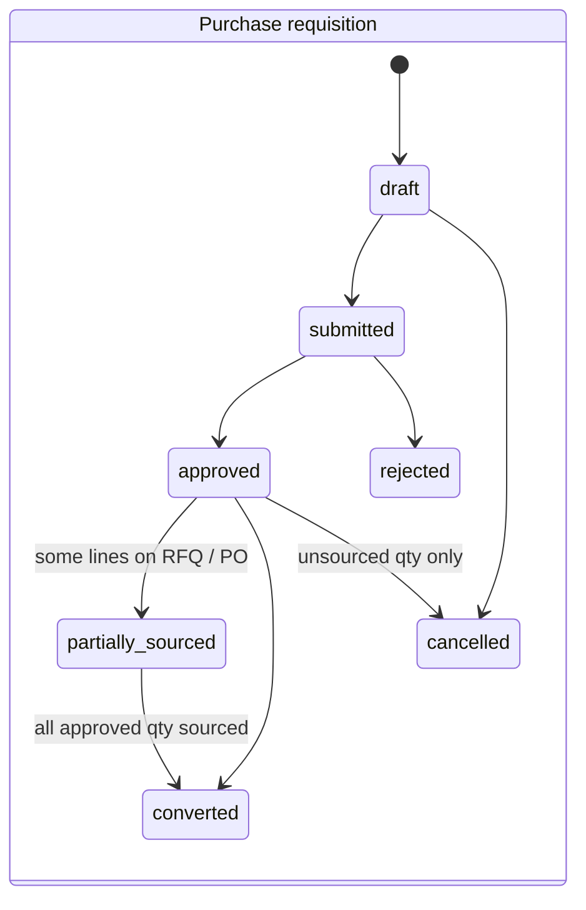
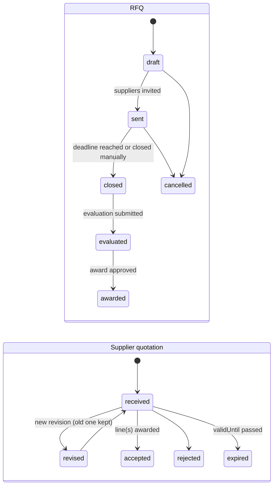
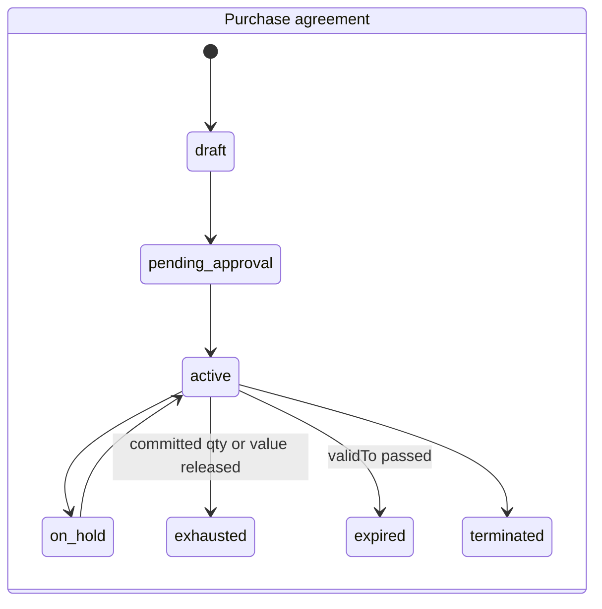
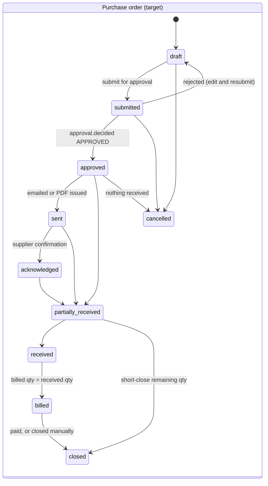

# Procurement — `procurement`

| | |
|---|---|
| Phase | P4 |
| Nest source | `reference/nest-api/src/modules/procurement (+ kernel/three-way-match)` |
| Routes | 36 — 33 in [generated/procurement.md](generated/procurement.md) + 3 `/procurement/three-way-match/*` (Nest `kernel/three-way-match` controller) |
| Feature flag | always on |
| Java package | `com.inventoryerp.procurement` |

## Purpose

Purchase requests, purchase orders, goods receipt notes (incl. ad-hoc), landed costs, debit notes, three-way match (PO/GRN/bill), GRNI report.

## Functional areas

| Area | Endpoints / scope |
|---|---|
| purchase requests | CRUD, submit, approve, reject (approval workflows) |
| purchase orders | CRUD, receive, pay, cancel, activate; `version` optimistic lock |
| goods receipts | adhoc, create, post (stock receipt + GRNI accrual), reverse |
| landed costs | CRUD, post, cancel |
| debit notes | CRUD, post, cancel (return to supplier) |
| three-way match | GET, recompute/:orderId, validate-bill/:billId |
| reports | GRNI |

## Business rules to reproduce exactly

1. PO status as Nest drives it: `draft` (only while a `purchase_order` approval request is pending) → `active` →
   `partially_received` → `received`; `cancelled` from anything but received / billed / closed. The other enum
   values (`submitted`, `approved`, `sent`, ...) exist in the schema but no Nest code path sets them.
2. Over-receipt is a hard block (no tolerance): `applyReceiptToPO` is the single writer of PO receipt status, shared
   by `POST /purchase-orders/:id/receive` and `PATCH /goods-receipts/:id/post`. Posting a GRN stocks the warehouse
   (Dr Stock Valuation / Cr GRNI); a PO-linked receipt is also vouchered (Dr GRNI + Dr Input Tax / Cr AP) and a cash
   PO is settled from the caller's open till (Dr AP / Cr Cash + drawer pay-out). Ad-hoc receipts leave GRNI open for
   the vendor bill.
3. Landed cost only on a posted GRN; charge total > 0; allocation by value | quantity | equal; share for units still on hand raises AVCO and debits Stock Valuation; share for units already consumed is expensed to COGS; STANDARD-cost items expense the whole share; posting period must be open; code prefix `LC-`.
4. Three-way match: bill qty/price vs GRN vs PO within tolerances; override requires `three_way_match:override`.

Error messages: copy verbatim from the "Error messages" table in the generated spec.

## Events

`purchase_request.created|submitted|approved|rejected`, `purchase_order.created|received|paid|cancelled|activated`,
`goods_receipt.posted`, `debit_note.created|posted`, `three_way_match.computed` — published fire-and-forget at the
same points as Nest. No subscribers in this module.

## Scheduled jobs

—

## Notes and pitfalls

- Landed-cost frontend panel: `web/src/features/procurement/landed-cost-panel.tsx`.

## Porting checklist

- [x] Read every file under "Source files to port" in the generated spec
- [x] Entities tuned (collections/locks/query methods) — none needed: services are JdbcClient SQL
- [x] DTO records with Bean Validation mirroring class-validator rules (untyped Nest bodies stay unvalidated maps)
- [x] Services: rules above + verbatim errors + same transaction/locking boundaries
- [x] Controllers: same paths/verbs/status/permissions/response shapes
- [x] Events published/consumed as in Nest
- [x] Jest specs ported; integration tests; authz + tenant isolation tests
- [ ] Parity scenarios `contract-tests/scenarios/procurement-*.json` — written, not yet run against a live Nest
- [ ] Web screens for this module work against Spring (no console errors) — not exercised
- [x] `docs/PORT_STATUS.md` updated

## Deviations

Pending owner approval:

1. **Line units (ADR-S003, V5).** PO lines snapshot `unitOfMeasureId` + `uomFactor` (default: the product's
   purchase unit); GRN lines (`uomId`, `uomFactor`) inherit the PO line's snapshot, or take `uomId` /
   the purchase unit on ad-hoc receipts; debit-note lines accept `uomId` (default: purchase unit) and a
   return-to-vendor ships `quantity x uomFactor` base units (Nest shipped `quantity` base units). Stock
   posting uses the snapshot; pre-V5 lines keep the live purchase-unit conversion. New 400s:
   `Unit <code> is not enabled for purchasing on product <name>`, `Unit <code> is not active for product
   <name>`.

Post-parity fixes (ADR-PROCUREMENT-001 wave 1, `fix(procurement)!`, 2026-10-30; tests:
`ProcurementIntegrityIT`, `ProcurementIT`, `InvoicingIT`):

| # | Route / behaviour | Nest | Spring now |
|---|---|---|---|
| P0-1 | PO receive / GRN post of a STANDARD-costed product | voucher debits GRNI at the standard; GRNI keeps the PPV, AP understated | voucher at the actual (supplier) value; GRNI nets to 0, AP = supplier price |
| P0-2 | `DELETE /purchase-orders/:id` | deletes an order that has receipts (GRN FK set null → AP raised again by the bill) | `400 Cannot delete a purchase order that has goods receipts, payments or bills — cancel it instead` |
| P0-3 | `PATCH /debit-notes/:id/post` | draft check outside the transaction; concurrent posts ship stock twice | atomic `draft → posted` claim first; the loser gets `409 Debit note was already posted by another request`; route takes an `Idempotency-Key` |
| P0-4 | `POST /purchase-orders/:id/pay` | pays draft orders and up to the ordered total before anything is received (AP in debit) | refuses draft (`Cannot pay a purchase order that is not approved yet`) and pays at most what posted receipts vouchered (`Nothing has been received on this purchase order yet — …`; the existing `exceeds remaining balance` message uses the vouchered remainder) |
| P0-5 | receipt / voucher / PO payment of a foreign-currency PO | posted the PO-currency amount as functional currency | converted with the PO exchange rate when the PO currency differs from the organisation's |
| P0-6 | `POST /purchase-orders` (`branchId`, `requestId`), `POST /goods-receipts` (`purchaseOrderId`, `partnerId`, `branchId`), detail includes | ids stored / read without an organisation check | `404 Branch / Purchase request / Purchase order / Supplier not found`; every include filtered by organisation |
| B1 | inbound non-RTV debit note | always `400 Unbalanced entry` | posts Dr expense / Cr AP (AP line tagged with the supplier) |
| B2 | `GET /vendor-bills/suppliers/:id/ledger` | drafts / cancelled bills counted, paid bills dropped → negative balance | the supplier's AP sub-ledger (all posted journal lines on payable accounts tagged with the supplier); closing balance = GL = AP ageing |
| B6 | `GET /purchase-orders?search=` | 500 | searches order number, description, notes and supplier name |
| B7 | `PATCH /goods-receipts/:id/reverse` | cancels draft landed costs before the refusal checks | cancels them only inside the reversal transaction, after the checks; the receipt row is locked and landed cost re-checked in the transaction |
| P1-1 | three-way match | sums draft / reversed receipts; billed = tax-inclusive even split of the bill total; double math; an unbilled receipt is `blocked`; write routes need only `:read` | posted receipts only; billed = net bill lines per product; BigDecimal; unbilled receipt = `partial`; `recompute` / `validate-bill` need `three_way_match:approve` |
| P1-2 | `POST /purchase-orders/:id/activate` | activates an order whose approval was rejected | `403 This purchase order's approval was rejected — it cannot be activated`; an approved request now activates the order automatically (`PurchaseOrderApprovalSubscriber`) |
| P1-3 | GRN reverse of a cancelled PO | set the PO back to active | cancelled / closed orders keep their status; received quantity floored at 0 |
| P1-7 | vendor bill priced above a vouchered receipt | difference silently dropped (AP at receipt value) | Dr PPV / Cr AP for the difference; bill residual carries it; receipt lines locked `FOR UPDATE` while matching |
| P1-12 | receiving a service / non-tracked product | put into stock and vouchered — and the bill expensed it again (AP twice) | not stocked, not vouchered; billed as an expense |

Same as Nest, kept on purpose:

- `GET /procurement/landed-costs/:id` answers 404 when missing, while the other detail routes answer 200 with an
  empty body (Nest returns `null`).
- Approval gates Nest calls outside `$transaction` (`checkOrRequestApproval` on GRN / debit-note post and PO
  receive; `requestApproval` during PO create) run in their own transaction (`REQUIRES_NEW` for PO create), so the
  approval request survives a later failure.
- `PATCH /purchase-orders/:id` sets `expectedDeliveryDate` to `null` when the field is omitted (Nest passes
  `null` explicitly) but leaves `description` / `notes` / `terms` untouched when omitted.
- Business timestamps Nest sets with `new Date()` use the database clock (`clock_timestamp()`), as in every module.

## Status

P4: 36/36 routes (33 procurement + 3 three-way-match). Services: `PurchaseRequestsService`,
`PurchaseOrdersService` (create with approval gate, receive, `applyReceiptToPO`, `settleCashReceipt`, pay, update,
cancel, remove, activate), `GoodsReceiptsService`, `LandedCostService` (value / quantity / equal allocation; serial,
lot, STANDARD and AVCO layers; books lock), `DebitNotesService` (incl. RTV), `GrniReconciliationService`; the
existing `kernel.threewaymatch.ThreeWayMatchService` got its controller.

Tests: `ProcurementIT` (22 tests) ports `procurement-flow.spec.ts` (credit/cash receive GL identity, partial →
received, over-receipt rollback, fully received, pay Dr AP / Cr Bank, overpay), `purchase-bill-matching.spec.ts`
(partial bill, PPV, cancel releases the receipt), `supplier-payment-withholding.spec.ts`, and the purchasing cases of
`inv-audit-purchasing` (H1-A, H1-B, H18), `inv-audit3-remediation` (P2-02 landed cost AVCO + FIFO lot),
`inv-p0-remediation` (INV-003 concurrent GRN post), `inv-p1-integrity` (N3 ×2, INV-012),
`inv-p2-accounting` (INV-010 GRN reversal) and `inv-readiness-remediation` (P0-2 ×2, P1-3); plus purchase
requests, PO admin + approval gate, GRN lifecycle, debit notes incl. RTV, GRNI report, three-way match,
receive idempotency + replay, tenant isolation and the authorization matrix (36 routes).

Not ported here: `lakeview-15day.sim.spec.ts` and `lakeview-m3.sim.spec.ts` drive POS services (P5) and are skipped
in Nest unless `SIM_RUN=1` against a `pos_stage1_*` database — port them with P5. `inv-p2-accounting` INV-011 (org-wide GL tie-out after document
flows) is not ported: it asserts zero variance over the whole org, which the shared DEMO test org cannot guarantee.

JaCoCo line coverage (full build): `procurement.application` 91.1 %, `procurement.web` 97.0 %,
`kernel.threewaymatch` 91.7 %.

Parity scenarios: `contract-tests/scenarios/procurement-purchasing.json`, `procurement-landed-cost.json` — not run
against a live Nest yet. Web procurement screens (incl. `landed-cost-panel.tsx`) not exercised against Spring.

## ADR-S007 extensions — landed cost vouchers, shipments, cost components (roadmap 1.8)

New routes (no Nest counterpart; legacy `/procurement/landed-costs` unchanged except that a list filtered by
`goodsReceiptId` also returns vouchers covering that receipt, and `post` refuses a voucher):

| Method | Path | Permission |
|---|---|---|
| GET | `/procurement/landed-cost-vouchers` (`status`, `shipmentId`) | `landed_cost:read` |
| GET | `/procurement/landed-cost-vouchers/{id}` · `/{id}/preview` | `landed_cost:read` |
| POST | `/procurement/landed-cost-vouchers` (Idempotency-Key) | `landed_cost:create` |
| PUT | `/procurement/landed-cost-vouchers/{id}` (draft) | `landed_cost:create` |
| POST | `/procurement/landed-cost-vouchers/{id}/submit` · `/cancel` | `landed_cost:create` |
| POST | `/procurement/landed-cost-vouchers/{id}/approve` | `landed_cost:approve` |
| POST | `/procurement/landed-cost-vouchers/{id}/post` (Idempotency-Key) | `landed_cost:post` |
| POST | `/procurement/landed-cost-vouchers/{id}/reverse` (Idempotency-Key) | `landed_cost:reverse` |
| GET/POST/PATCH | `/procurement/shipments`, `/{id}`, `/{id}/receipts`, DELETE `/{id}/receipts/{grnId}` | `landed_cost:read` / `create` |
| GET | `/procurement/cost-components` | `landed_cost:read` |
| POST/PATCH | `/procurement/cost-components`, `/{id}` | `landed_cost:configure` |
| GET | `/procurement/landed-cost-reports/{by-shipment,by-item,by-supplier,product-profitability}?from&to`, `/clearing` | `landed_cost:read` |

LC-0 (ADR-S053, extension routes, additive): voucher charge lines accept `taxId` and `taxRecoverable`
(`false` = tax is part of the charge, capitalised / expensed with it). A charge with tax must resolve its
recoverability from its tax, its cost component's tax or `costing.landedCost.taxRecoverableDefault`, or state it;
contradicting a derived value needs `landed_cost:override_tax`. A `recoverable_tax` charge cannot carry tax.

GL per posted voucher: Dr stock (capitalised, per product stock account) · Dr COGS (consumed share, voucher cost
centre) · Dr expense (expensed charges, charge cost centre) · Dr `tax_receivable` (recoverable tax) / Cr each charge's
credit account, default landed-cost clearing `2155` (`landed_cost_clearing`). Reversal = reversing entry + Dr stock /
Cr COGS for the part sold since. A posted voucher blocks reversal of any of its receipts.

Supplier payables (V14, ADR-S007 §2a): charge field `billMode` = `generate | link | none` (+ `vendorBillId`,
`dueDate`). `generate` (default when a supplier + invoice no. are given and no credit account): posting also raises
one posted vendor bill per (supplier, invoice no.) — `sourceType = 'landed_cost'`, `sourceDocument` = voucher code,
lines Dr `2155` (charge + tax) / Cr that supplier's payable; charges of one invoice must share currency and rate.
`link`: references a bill already booked against clearing. Reversal cancels generated bills and is refused
(`Supplier bill … has payments; …`) once one is paid. `GET /{id}` adds `charges[].vendorBill` and a `suppliers[]`
summary (charges, tax, invoices with bill number / status / residual).

Tests: `LandedCostVoucherIT` (laptop 2,380,000 / unit; 19M + 19M after half sold; cement / steel 1.8M / 1.2M; weight;
manual; selected lines; expense with cost centre; recoverable tax; duplicate supplier invoice; workflow; reversal;
FIFO lots across a shipment; idempotent replay; GRN reversal block; tenant isolation; multi-supplier shipment with
two goods vendors, generated + linked supplier bills, supplier-scoped charge, paid-bill reversal guard; bill-mode
validation and one bill per invoice). Web: Landed Costs, Import
Shipments, Landed Cost Reports (incl. cost components) under Purchases.

## Phase 4 additions (built, unverified)

PROC-4: `GET /procurement/reports/supplier-performance?from&to&partnerId` (`purchase_order:read`), default the last 90 days.
Screen `/procurement/supplier-performance`. Tests: `SupplierPerformanceIT`, `SupplierPerformanceServiceTest`. Nothing was compiled or run.

## Phase 4 RFQ (PROC-1) — superseded

Replaced by the Source-to-Pay RFQ (wave 4, `/procurement/rfqs`, `SourcingIT`) when the S2P branch merged.

## Phase 4 price agreements (PROC-2) — superseded

Replaced by S2P purchase agreements (`/procurement/agreements`) and supplier price history
(`/procurement/suppliers/price-history`).

## Phase 4 handling test (added, not run)

PROC-6: `LandedCostVoucherIT.handlingByQuantity` asserts the seeded HANDLING component capitalizes, spreads by quantity and balances. No production code changed. The test was not run.
## Budgets, spend control and delegation (PROC-3)

Status: built, not compiled, not run. Tests in `ProcurementControlIT`. Decisions in `docs/DECISIONS_FOR_OWNER.md`.

- `/procurement/budgets` (list, get, create, update draft, `activate`, `close`, `revise`, delete draft). Permissions `procurement_budget:read|manage`.
- `POST /procurement/budget-check`: preview for forms, permission `purchase_request:read`.
- `/procurement/delegations` (list, create, update, delete). Permissions `procurement_delegation:read|manage`, and `procurement_delegation:central` for central buyers.
- `ProcurementBudgetService.enforce` locks the active budget rows in id order inside the document's transaction. A refusal is a 409 with code `PROCUREMENT_BUDGET_EXCEEDED`.
- `POST /procurement/purchase-orders` and `POST /procurement/purchase-requests` accept an optional `departmentId`. Responses do not change.
- The `purchase_order` approval snapshot now carries `branchId` and `departmentId`, so CTRL-1 conditions apply.

## Purchase request approval (PROC-5)

Status: built, not compiled, not run. Tests in `ProcurementControlIT`.

Entity type `purchase_request`, raised on submit with snapshot `amount` (estimated value, base currency), `branchId`, `departmentId`. `PATCH .../approve` and `.../reject` decide the pending request through the engine. `PurchaseRequestApprovalSubscriber` applies inbox decisions, idempotently. `GET .../{id}/approval` returns the latest request with its decisions, or an empty body when no workflow applied. Without a workflow nothing changes.

## Target Source-to-Pay design (ADR-PROCUREMENT-001)

Status: **proposed**. Nothing in this section is built yet. Evidence:
[`docs/audit/procurement-current-state-audit.md`](../audit/procurement-current-state-audit.md). Delivery order:
[`docs/roadmap/procurement-roadmap.md`](../roadmap/procurement-roadmap.md).

Companion specs:
- [`procurement-postings.md`](procurement-postings.md): debit / credit rules.
- [`procurement-landed-cost.md`](procurement-landed-cost.md).
- [`procurement-approval-policies.md`](procurement-approval-policies.md): policies, approvals, authorization matrix.
- [`procurement-integration-contracts.md`](procurement-integration-contracts.md): ports and events.

All of it is additive. The parity routes above keep their path, verb, permission and JSON. With no policy configured,
behaviour equals today's.

### Purchasing routes (not every purchase follows every step)

| Route | Steps | Example |
|---|---|---|
| `direct` | PO → GRN → bill → payment | Small office purchase under the direct-PO threshold |
| `requisition` | PR → PO → GRN → bill | Routine store replenishment |
| `competitive` | PR → RFQ → quotations → evaluation and award → PO → … | Above the RFQ threshold |
| `agreement` | Agreement → release (PO) → GRN → bill | Aggregate or fuel under a rate contract |
| `planned` | Reorder rule or MRP → PR (auto) → … | Cement for block production |
| `emergency` | PO (flagged) → GRN → bill, then post-review | Crusher breakdown spare part |
| `capital` | PR → RFQ → award → PO → GRN → bill → asset | Truck, crusher, generator |
| `service` | PO (service lines) → service entry sheet → bill | Equipment hire, repairs, haulage |

`ProcurementPolicy.route.*` chooses which routes are allowed per amount, category and branch (approval-policies spec §3).

### State machines

Today's `active` status stays as an alias. A PO created with no approval required goes straight to `approved`, and
parity JSON keeps reporting `active` (mapping table in the approval-policies spec §5). Hard delete is allowed only in
`draft` with no GRN (fix for P0-2).

```mermaid
stateDiagram-v2
    direction LR
    state "PO change request" as CR {
        [*] --> draft
        draft --> pending_approval
        pending_approval --> approved
        pending_approval --> rejected
        approved --> applied: new PoRevision; PO lines updated
    }
    state "GRN / service entry" as GRN {
        [*] --> draft
        draft --> inspection: inspection required by policy
        inspection --> posted: accepted qty posted
        draft --> posted
        draft --> cancelled
        posted --> reversed
    }
    state "Incoming inspection" as QI {
        [*] --> pending
        pending --> passed
        pending --> partially_accepted
        pending --> failed
        failed --> claimed: supplier claim raised
    }
```

### Proposed entities

New tables (`V{n}__procurement_<area>.sql`). They are org-scoped (`organizationId` plus RLS policy like the
baseline), use UUID ids, carry `version` for optimistic locking, and have `createdAt`/`updatedAt`/`createdBy`.

| Area | Entity | Key fields | Relations |
|---|---|---|---|
| Supplier | `SupplierProfile` | `partnerId` (unique), `lifecycleStatus` (prospect / provisional / approved / suspended / blacklisted), `riskClass`, `categories[]`, `currencyCode`, `leadTimeDays`, `approvedById/At` | 1:1 `Partner` |
| | `SupplierBankAccount` | `bankName`, `accountNumberMasked`, `accountNumberEnc`, `currency`, `status` (pending_verification / verified / revoked), `verifiedById` (must differ from `createdBy`) | n:1 profile |
| | `SupplierCertificate` | `type` (TIN, trade licence, explosives licence, ISO, KS/UNBS), `number`, `validFrom/To`, `fileId` | n:1 profile; expiry alert job |
| | `SupplierProduct` | `productId`, `supplierSku`, `purchaseUomId`, `minOrderQty`, `leadTimeDays`, `preferred` | price history = `SupplierPrice` |
| | `SupplierPrice` | `productId`, `uomId`, `currency`, `unitPrice`, `validFrom/To`, `source` (quotation / agreement / PO / manual) | append-only |
| | `SupplierScorecardPeriod` | period, `onTimePct`, `inFullPct`, `rejectPct`, `priceIndex`, `leadTimeAvg`, `score` | computed nightly (ShedLock) |
| Requirements | `PurchaseRequestLine` (exists) + columns `sourcedQuantity`, `orderedQuantity`, `costCenterId`, `projectId`, `requiredDate`, `deliveryLocationId`, `demandSource` (manual / reorder / mrp / maintenance / project), `demandRef` | | PR (exists) |
| Sourcing | `Rfq`, `RfqLine`, `RfqSupplier` | `deadline`, `deliveryTerms`, `evaluationTemplateId`; invite status | RfqLine → PR line(s) (n:m via `RfqLineSource`) |
| | `SupplierQuotation`, `SupplierQuotationLine` | `revision`, `validUntil`, `unitPrice`, `currency`, `leadTimeDays`, `freightIncluded`, `paymentTermId` | → Rfq / RfqSupplier |
| | `EvaluationTemplate`, `EvaluationCriterion` | criterion (price / quality / delivery / terms / performance), `weightPct` (sum 100) | per category |
| | `SourcingEvaluation`, `SourcingScore` | evaluator, per-supplier per-criterion score, `justification` | → Rfq |
| | `SourcingAward`, `SourcingAwardLine` | awarded quotation line, qty, `reason`, approval | creates PO line(s) or agreement |
| Agreements | `PurchaseAgreement`, `PurchaseAgreementLine` | `type` (blanket / rate / scheduled), `validFrom/To`, `committedQty`/`committedValue`, `releasedQty`/`releasedValue`, `price`, `tolerancePct` | releases = PO with `agreementLineId` |
| PO | `PurchaseOrderLine` (exists) + columns `agreementLineId`, `requestLineId`, `lineType` (goods / service / asset / expense), `deliveryLocationId`, `projectId`, `costCenterId`, `cancelledQuantity` | | |
| | `PurchaseOrderSchedule` | line, `dueDate`, qty, location | |
| | `PoRevision` | `revisionNo`, `snapshot` jsonb, `reason`, `approvedById` | uses existing `PurchaseOrder.snapshot` for revision 0 |
| | `PoChangeRequest` | changes jsonb, `status`, approval | → `PoRevision` |
| | `SupplierConfirmation` | `confirmedAt`, `supplierRef`, `promisedDate`, deviations jsonb | |
| Receiving | `GoodsReceiptLine` (exists) + columns `rejectedQuantity`, `acceptedQuantity`, `weighbridgeTicketId`, `inspectionId`, `deliveryNoteRef`, `projectId` | | |
| | `ServiceEntrySheet`, `ServiceEntryLine` | period, `acceptedValue`, acceptor | → PO service line |
| | `IncomingInspection`, `InspectionResult` | plan (re-use `QcPlan` shape), parameter results, decision, photos (files) | → GRN line |
| | `SupplierClaim` | type (shortage / quality / damage / price), qty, amount, status (open / credit_requested / settled / rejected) | → GRN line, debit note, supplier credit note |
| Budget | `Commitment` (accounting) | source (PR / PO), account / cost centre / project, amount, relieved amount | relieved by GRN / bill |
| Policy | `ProcurementPolicy`, `ProcurementPolicyVersion` | scope, key, value jsonb, `effectiveFrom`, status | approval-policies spec |

### Extension routes (all under `/api/v1`)

Every route takes `@RequirePermissions`. Every POST or PATCH that moves stock, money or commitment requires an
`Idempotency-Key`. Lists use the standard envelope (`CONTRACT.md`).

| Method | Path | Permission |
|---|---|---|
| GET/POST/PATCH | `/procurement/suppliers/{partnerId}/profile` | `supplier:read` / `supplier:manage` |
| POST | `/procurement/suppliers/{partnerId}/profile/{approve,suspend,blacklist,reinstate}` | `supplier:approve` |
| GET/POST | `/procurement/suppliers/{partnerId}/bank-accounts`, POST `/{id}/verify` | `supplier:manage` / `supplier:verify_bank` |
| GET/POST/DELETE | `/procurement/suppliers/{partnerId}/certificates` | `supplier:manage` |
| GET | `/procurement/suppliers/{partnerId}/scorecard`, `/price-history?productId` | `supplier:read` |
| POST | `/procurement/purchase-requests/{id}/cancel`, `/consolidate` (body: request ids) | `purchase_request:update` |
| GET | `/procurement/purchase-requests/open-lines` (sourcing workbench) | `rfq:read` |
| GET/POST/PATCH | `/procurement/rfqs`, `/{id}` | `rfq:read` / `rfq:manage` |
| POST | `/procurement/rfqs/{id}/{send,close,cancel}` | `rfq:manage` |
| GET/POST | `/procurement/rfqs/{id}/quotations`, POST `/quotations/{qid}/revise` | `rfq:read` / `rfq:manage` |
| GET | `/procurement/rfqs/{id}/comparison` | `rfq:read` |
| POST | `/procurement/rfqs/{id}/evaluation`, `/award` | `rfq:evaluate` / `rfq:award` |
| POST | `/procurement/awards/{id}/create-orders` (Idempotency-Key) | `purchase_order:create` |
| GET/POST/PATCH | `/procurement/agreements`, `/{id}`, POST `/{id}/{submit,activate,hold,terminate}` | `purchase_agreement:read` / `manage` / `approve` |
| POST | `/procurement/agreements/{id}/releases` (Idempotency-Key) | `purchase_order:create` |
| POST | `/procurement/purchase-orders/{id}/{submit,send,acknowledge,short-close}` | `purchase_order:update` / `send` |
| GET/POST | `/procurement/purchase-orders/{id}/change-requests`, POST `/{crId}/{submit,apply}` | `purchase_order:update` / `approve` |
| GET | `/procurement/purchase-orders/{id}/revisions` | `purchase_order:read` |
| GET/POST | `/procurement/service-entries`, POST `/{id}/{accept,reverse}` (Idempotency-Key) | `goods_receipt:create` / `post` |
| GET/POST | `/procurement/inspections`, POST `/{id}/decide` | `inspection:read` / `inspection:decide` |
| GET/POST/PATCH | `/procurement/claims`, POST `/{id}/{submit,settle,reject}` | `supplier_claim:manage` |
| GET | `/procurement/documents/{type}/{id}/trace` | type's `:read` |
| GET/POST | `/procurement/policies`, POST `/{id}/{approve,activate}` | `procurement_policy:read` / `manage` / `approve` |
| GET | `/procurement/reports/{open-orders,overdue,spend,price-variance,supplier-performance,commitments,emergency}` | `procurement_report:read` |

New permission keys are added to `packages/shared/src/permissions.ts`, then `node tools/contracts2java/generate.mjs`
is run. The migration grants them to Administrator, following the ADR-S007 / V12 pattern.

### Industry requirements (construction materials)

- **Weighbridge-controlled receipts.** Policy `receiving.weighbridgeRequired`, per category (aggregate, sand, cement
  bulk), makes a GRN line post only with a completed `WeighbridgeTicket` (`subjectType='purchase_receipt'`) whose net
  weight converts to the line unit. The existing `WeighbridgeTicketService.feedGoodsReceipt` stays the producer, and a
  manual override needs `goods_receipt:override_weighbridge` plus a reason (audited).
- **UoM with density.** Tonne ↔ m³ uses a per-product (or per-lot) density on `ProductUom`. This depends on ADR-S003
  approval and the line-unit work in `AUTONOMOUS_BUILD_CONSTRUCTION.md` Phase 4.
- **Direct-to-site.** A PO line has `deliveryLocationId` of type `virtual/site` plus `projectId`. Its GRN is a *site
  acceptance*: expensed to the project or WIP account, or stocked at a site location per policy. The acceptor is
  recorded.
- **Controlled items** (explosives, detonators). A category flag `controlled=true` requires a supplier certificate of
  type `explosives_licence` that is valid on the PO date, a named recipient, and a quantity check against the permit.
  Each movement is written to the audit log.
- **Emergency purchases.** `emergency=true` with a justification. It skips RFQ but not approval (an emergency
  approver role). It appears in `/reports/emergency` and must be post-reviewed within N days (policy).
- **Capital purchases.** `lineType=asset` posts to `fixed_asset_clearing`. The GRN or bill emits `asset.acquired` to
  `fixedasset`, which creates the asset from `AssetAcquisition` (integration contracts §4).
- **Equipment spares.** `SupplierProduct` plus a product attribute `compatibleEquipment[]`, so a maintenance work order
  (fleet) can raise a PR with `demandSource=maintenance`.

### Built — wave 2 (policies, suppliers, approvals; `V151__procurement_policy_supplier.sql`)

| Method | Path | Permission |
|---|---|---|
| GET | `/procurement/policies/definitions` · `/resolve?key&branchId&categoryId&…` · `/` · `/{id}` | `procurement_policy:read` |
| POST / PATCH | `/procurement/policies` (draft) · `/{id}` (draft edit) | `procurement_policy:manage` |
| POST | `/procurement/policies/{id}/approve` (not by the author) | `procurement_policy:approve` |
| POST | `/procurement/policies/{id}/activate` · `/{id}/cancel` | `procurement_policy:manage` |
| GET | `/procurement/suppliers` (paged, `search`, `status` incl. `unqualified`) · `/{partnerId}` · `/{partnerId}/eligibility` · `/certificates/expiring?days` · `/price-history?productId&partnerId` | `supplier:read` |
| PUT | `/procurement/suppliers/{partnerId}/profile` · `/{partnerId}/products` | `supplier:manage` |
| POST | `/procurement/suppliers/{partnerId}/profile/{approve,provisional,suspend,blacklist,reinstate}` | `supplier:approve` |
| POST | `/procurement/suppliers/{partnerId}/bank-accounts` · `/bank-accounts/{id}/revoke` · `/{partnerId}/certificates` · `/{partnerId}/prices` | `supplier:manage` |
| POST | `/procurement/suppliers/bank-accounts/{id}/verify` (not by the person who entered it) | `supplier:verify_bank` |
| DELETE | `/procurement/suppliers/certificates/{id}` · `/products/{id}` | `supplier:manage` |

Policy keys enforced: `supplier.approvedRequired` (off / warn / block, PO create; suspended / blacklisted suppliers are
always refused), `supplier.certificatesRequired` (per category, PO create), `route.requisitionRequiredAbove` (PO create
needs an approved request above the amount), `receiving.overReceiptTolerancePct` (receipt limit). Daily job
`ProcurementPolicyJob` (`app.procurement.daily-cron`, ShedLock) activates due policies and emits
`supplier.certificate_expiring`. Approvals: an approval covers the amount it was granted for — a larger amount on
the same entity opens a new request (`ApprovalsService.checkOrRequestApproval`); a bill's creator cannot approve it
by posting with `overrideApproval`. Every PO line is recorded in the supplier price history. Tests:
`ProcurementSupplierPolicyIT`. Web: Supplier Register, Supplier 360, Purchasing Policies (Purchases menu); every
procurement route is now permission-guarded (`web/src/pages/procurement/routes.tsx`).

### Built — wave 3 (requisition to order, order lifecycle; `V152__procurement_core.sql`)

| Method | Path | Permission |
|---|---|---|
| GET | `/procurement/sourcing/open-lines?requestId&productId` (approved request lines still to order, suggested supplier, last price) | `purchase_order:create` |
| POST | `/procurement/sourcing/orders` (Idempotency-Key required; request lines locked, never ordered twice; a fully ordered request becomes `converted`) | `purchase_order:create` |
| POST | `/procurement/purchase-requests/{id}/cancel` (no orders yet) | `purchase_request:update` |
| GET | `/procurement/purchase-orders/{id}/lifecycle` (stage, lines with open / cancelled qty, receipts, bills, approvals) | `purchase_order:read` |
| POST | `/procurement/purchase-orders/{id}/send` · `/{id}/acknowledge` (`supplierReference`, `promisedDate`) | `purchase_order:send` |
| POST | `/procurement/purchase-orders/{id}/short-close` (reason; undelivered balance cancelled and returned to the request) · `/{id}/close` (fully received) | `purchase_order:cancel` |
| GET | `/procurement/reports/open-orders?partnerId&overdueOnly` | `purchase_order:read` |
| GET | `/procurement/suppliers/options?search` (supplier picker for buyers) | `purchase_order:read` |

Parity create request lines additionally accept `requiredDate`, `deliveryLocationId`, `preferredSupplierId`,
`costCenterId`, `projectId` (additive). Order statuses stay parity values: short-close ends in `closed` (anything
received) or `cancelled`; `closed` orders refuse receipts. Service acceptance uses the goods receipt of service lines
(no stock, no voucher — wave 1 P1-12); a separate service entry sheet was not needed. Tests: `RequisitionToOrderIT`.
Web: New Purchase Request form (fixes the dead link), Sourcing Workbench, Order progress card on the PO page (send /
confirmation / short-close / close / print), printable PO, Open Orders report; the PO form's supplier picker lists
suppliers only.

### Built — wave 4 (strategic sourcing; `V153__procurement_sourcing.sql`)

| Method | Path | Permission |
|---|---|---|
| GET | `/procurement/rfqs?status&search&page&limit` · `/rfqs/{id}` | `rfq:read` |
| GET | `/procurement/rfqs/{id}/comparison` (delivered cost per supplier and line — price + freight spread by value, converted to functional currency — weighted score, recommended supplier) | `rfq:read` |
| POST | `/procurement/rfqs` (`title`, `requestLineIds` and/or free `lines`, `supplierIds`, `weights`) | `rfq:manage` |
| POST / DELETE | `/procurement/rfqs/{id}/suppliers` · `/{id}/suppliers/{partnerId}` | `rfq:manage` |
| POST | `/procurement/rfqs/{id}/send` · `/close` · `/cancel` · `/quotations` (each new quote is a revision) · `/decline` | `rfq:manage` |
| POST | `/procurement/rfqs/{id}/award` (per line, split quantities allowed; `justification` required when not the lowest delivered cost; `rfq_award` approval workflow when configured) | `rfq:award` |
| POST | `/procurement/rfqs/{id}/orders` (Idempotency-Key required; one PO per awarded supplier, request lines locked) | `purchase_order:create` |
| GET | `/procurement/agreements?status&partnerId` · `/agreements/{id}` | `purchase_agreement:read` |
| POST | `/procurement/agreements` (blanket or rate contract, validity, quantity / value caps) | `purchase_agreement:manage` |
| POST | `/procurement/agreements/{id}/activate` (maker ≠ checker; agreed prices recorded in the supplier price list) | `purchase_agreement:approve` |
| POST | `/procurement/agreements/{id}/hold` · `/resume` · `/terminate` (reason) | `purchase_agreement:manage` / `:approve` |
| POST | `/procurement/agreements/{id}/releases` (Idempotency-Key required; agreement lines locked, quantity and value caps enforced, `exhausted` when used up) | `purchase_order:create` |

Request lines on an open RFQ are hidden from the sourcing workbench and cannot be ordered directly ("award the RFQ
instead"). Cancelling or short-closing an order returns its open balance to the request lines and to the agreement
(quantity and value), reopening a converted request or an exhausted agreement. Expired agreements are closed by the
daily procurement job. Events: `rfq.sent`, `rfq.awarded`, `agreement.activated`, `agreement.exhausted`,
`purchase_order.closed`. Tests: `SourcingIT`. Web: RFQ list and detail (supplier invitations, quote entry, side-by-side
comparison, award per line, create orders), "Request quotations" on the sourcing workbench, purchase agreement list and
detail (release with remaining-quantity bars, hold / resume / terminate).

### Built — wave 5 (enterprise controls; `V154__procurement_controls.sql`)

| Method | Path | Permission |
|---|---|---|
| GET | `/procurement/commitments?sourceType&sourceId&accountId&status&page&limit` (open purchase commitments per line, `{data, meta}`) | `commitment:read` |
| GET | `/procurement/purchase-orders/{id}/changes` (change requests, current revision, revision snapshots) | `purchase_order:read` |
| POST | `/procurement/purchase-orders/{id}/changes` (Idempotency-Key required; `reason`, line `quantity` / `unitPrice`, `expectedDeliveryDate`) | `po_change:request` |
| GET | `/procurement/po-changes/pending` | `po_change:approve` |
| POST | `/procurement/po-changes/{id}/approve` (Idempotency-Key required; not the requester) · `/{id}/reject` (note) | `po_change:approve` |
| POST | `/procurement/po-changes/{id}/cancel` (requester withdraws) | `po_change:request` |
| GET | `/procurement/bills/{billId}/duplicates` | `expense:read` |
| GET | `/procurement/claims?status&partnerId&purchaseOrderId&page&limit` · `/claims/{id}` | `supplier_claim:read` |
| POST | `/procurement/claims` · `/{id}/submit` · `/{id}/accept` (agreed `amount`) · `/{id}/reject` (`response`) · `/{id}/cancel` | `supplier_claim:manage` |
| POST | `/procurement/claims/{id}/settle` (Idempotency-Key required; creates the draft outbound debit note) | `supplier_claim:manage` |

**Commitments** (accounting `CommitmentService`, memo table `Commitment`, never GL): an order commits open
quantity × unit price × functional rate per line once it is approved (`active`); receipts relieve it, cancel /
short-close release it, a goods-receipt reversal re-commits it, and an applied change re-states it. Budget account per
line: the stock account for stocked products (stock accounts cannot carry budgets, so stock purchases are not budget
controlled), otherwise the category expense account or `default_expense`. Cost centre / project come from the sourcing
request line. `GET /budgets/{id}/vs-actual` rows and the expense total gain `committed` and `available` (additive).

**Policies** (all default to the previous behaviour):
- `budget.control`: `off` / `warn` / `block` / `block_with_override` (`budget:override`). It runs when an order is
  raised. Available = budget − posted actuals − other open commitments. Warnings are returned in the order's
  `warnings`.
- `match.mode` (`three_way` / `two_way`), `match.priceTolerancePct` (empty = the `procurement.match_tolerance` flag) and
  `match.qtyTolerancePct` feed `ThreeWayMatchService` through the kernel `MatchToleranceProvider` SPI.
- `bill.duplicateCheck`: `off` / `warn` / `block`. A duplicate is the same supplier with the same reference (ignoring
  case and spaces), or the same total within 7 days. `block` answers 409. `warn` adds `warnings` to the posted bill
  and emits `bill.duplicate_suspected`. It is wired through the invoicing `VendorBillPostGuard` SPI.
- `change.reapprovalAbovePct`: a change that raises the total beyond this percentage waits for `po_change:approve`.
  With 0, every increase waits. Decreases apply at once.

**Order changes**:
- One open change per order.
- Quantity cannot go below received + short-closed.
- A line with receipts keeps its price; raise a price claim instead.
- Lines released from an agreement change on the agreement.
- Applying a change writes revision 0 (the original) once and then revision n. It updates the request lines' ordered
  quantity, clears the supplier confirmation and emits `purchase_order.changed`.

**Supplier claims**: shortage, damage, quality, price, late delivery or other. They can be linked to an order, receipt
or bill of the same supplier, and are settled by a draft outbound debit note that posts through the normal flow. A
bill priced below the vouchered receipt is settled the same way, with a price claim.

Tests: `ProcurementControlsIT`. Web:
- An order-changes card on the PO page: request dialog, approve or reject, and a revision diff.
- An order changes inbox, a supplier claims page and a budget commitments register.
- Committed and available columns on budget versus actual.
- New policy groups on the purchasing policies page.

Not built in this wave: the `goods_in_transit` invoice-before-receipt mode. It is deferred to the landed-cost work,
because it needs a transit-stock account design.

### Built — wave 6 (receiving quality and industry controls; `V155__procurement_industry.sql`)

| Method | Path | Permission |
|---|---|---|
| GET | `/procurement/inspections?status&goodsReceiptId&purchaseOrderId` · `/inspections/{id}` | `inspection:read` |
| POST | `/procurement/goods-receipts/{id}/inspection` (open; idempotent per receipt) | `inspection:manage` |
| POST | `/procurement/inspections/{id}/results` (line accepted / rejected qty, defect notes, evidence `fileIds`) · `/{id}/cancel` | `inspection:manage` |
| POST | `/procurement/inspections/{id}/complete` (Idempotency-Key required; rejected value → quality claim) | `inspection:manage` |
| POST | `/procurement/purchase-orders/{id}/emergency` (`reason`) | `purchase_order:update` |
| POST | `/procurement/purchase-orders/{id}/emergency-review` (`note`; not the buyer) · GET `/procurement/reports/emergency?reviewed` | `emergency_purchase:review` |

**Policies** (default off; set per branch or product category):
- `receiving.weighbridgeRequired`: a goods receipt of those products posts only with a completed weighbridge ticket on
  the line. Evidence comes from the `ReceiptEvidenceProvider` SPI, which fleet implements from `WeighbridgeTicket`.
  Direct PO receipts are refused, because they can carry no ticket. `receiving:override_evidence` may override, and
  the override is audited.
- `receiving.inspectionRequired`: posting the receipt opens an inspection. A supplier bill linked to the order is held
  ("Incoming inspection … is still open") until the inspection completes. Completing it raises a quality claim for
  rejected qty × order price.

The PO lifecycle view now also returns `isEmergency`, `emergencyReason` and `emergencyReviewedAt`. Tests:
`ReceivingQualityIT`. Web: an incoming-inspection queue with a result dialog, the emergency purchases review page, and
an emergency flag on the PO page.

**Deferred** (the plan's other P4 items):
- Landed-cost gaps G1–G8 beyond what V12–V25 already provide.
- Direct-to-site project acceptance.
- `asset.acquired` hand-off to fixed assets.
- Density-based t ↔ m³ conversion.
- `goods_in_transit`.

They are tracked in `docs/roadmap/procurement-roadmap.md`.

### Built — wave 7 (planning, supplier portal, analytics; `V156__procurement_planning.sql`)

| Method | Path | Permission |
|---|---|---|
| GET / PUT | `/procurement/replenishment/rules` (upsert per product + store) · DELETE `/rules/{id}` | `replenishment:read` / `:manage` |
| GET | `/procurement/replenishment/suggestions?all` | `replenishment:read` |
| POST | `/procurement/replenishment/raise` (`ruleIds`; one draft purchase request, demand source `reorder`) | `replenishment:manage` |
| GET | `/procurement/analytics/scorecards` · `/scorecards/{partnerId}` · `/spend?groupBy=supplier\|category\|branch\|month` · `/forecast?productId&locationId` · `/alerts` (`from`, `to` default to the last 12 months) | `procurement_analytics:read` |
| GET | `/procurement/analytics/price-check?productId&partnerId&unitPrice` | `purchase_order:read` |
| POST / GET | `/procurement/portal-links` (`documentType` rfq / purchase_order, `documentId`, `partnerId`, `days` 1–90) · POST `/portal-links/{id}/revoke` | `supplier_portal:manage` |
| GET | `/supplier-portal/{token}` · POST `/{token}/quotation` · `/{token}/decline` · `/{token}/confirm` | **public** (token only; 30 / 10 requests a minute per IP) |

**Replenishment.**
- Position = on hand at the store + open order quantity + open request quantity.
- Daily use = the last 90 days of outflows (issues, consumption, waste), excluding transfers and reversals, ÷ 90.
- `min_max` orders up to max when the position is below min.
- `reorder_point` orders when the position is at or below daily use × lead time + safety stock.
- Quantities round up to the order multiple.
- Rules marked `autoRaise` are raised nightly by `ProcurementPolicyJob`, which emits `replenishment.raised`.

**Analytics** (statistics only, no external service).
- Scorecard: on-time %, in-full %, inspection reject %, claims, lead time, spend, and a score = 35 on-time + 25 in-full
  + 25 quality + 15 claims, graded A–D. Missing data counts as neutral.
- Price check: z-score against 12 months of `SupplierPrice` for the supplier, falling back to all suppliers when the
  supplier has fewer than 5 points. A price is flagged when |z| > 2 with at least 5 observations.
- Forecast: simple exponential smoothing (α 0.3) of monthly consumption.
- Alerts:
  - late deliveries
  - inspection reject rate above 10 %
  - single-source items (one supplier, 3 or more orders in 12 months)
  - certificates expiring within 30 days

**Supplier portal.**
- A random 256-bit token is issued once. Only its SHA-256 hash is stored.
- Each token is scoped to one document and one supplier, expires, can be revoked, and has its use counted.
- Every action is audited and emits `supplier_portal.used`.
- Through the token the supplier can only view the document and answer it:
  - quote or revise, which feeds the RFQ comparison and price history
  - decline the RFQ
  - confirm the PO with a reference and promised date, which becomes the order acknowledgement

Tests: `PlanningIT`. Web:
- A purchasing dashboard: KPI tiles, alerts, spend by supplier and by month, and a scorecard table.
- A replenishment page with a rule dialog.
- A public `/supplier-portal/:token` page, outside the login.
- "Supplier link" buttons on RFQ suppliers and on the PO progress card.
